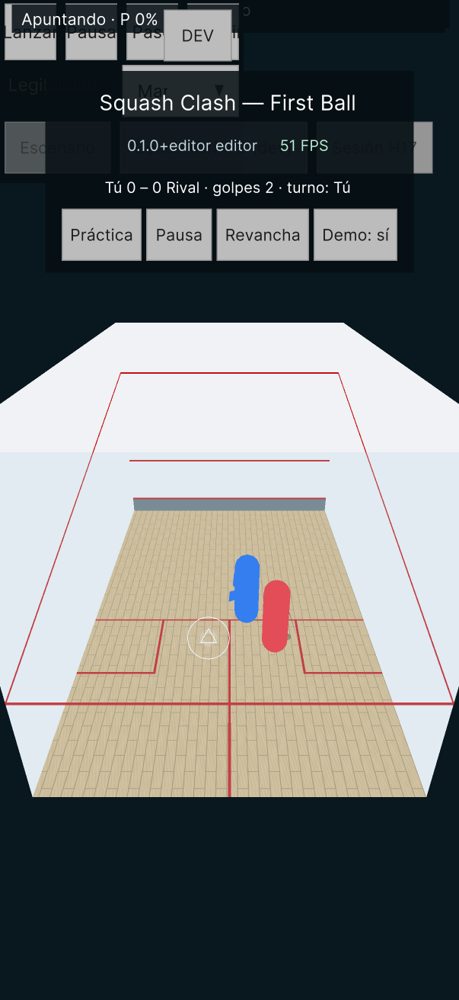
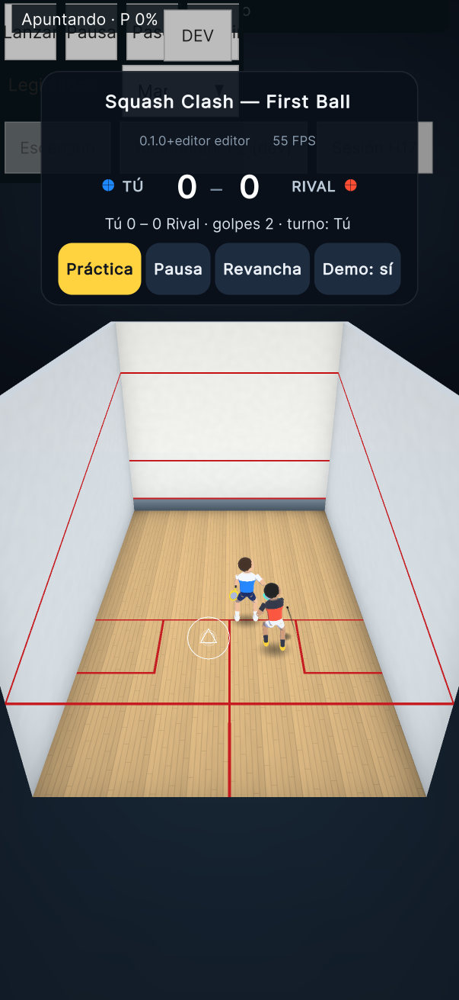
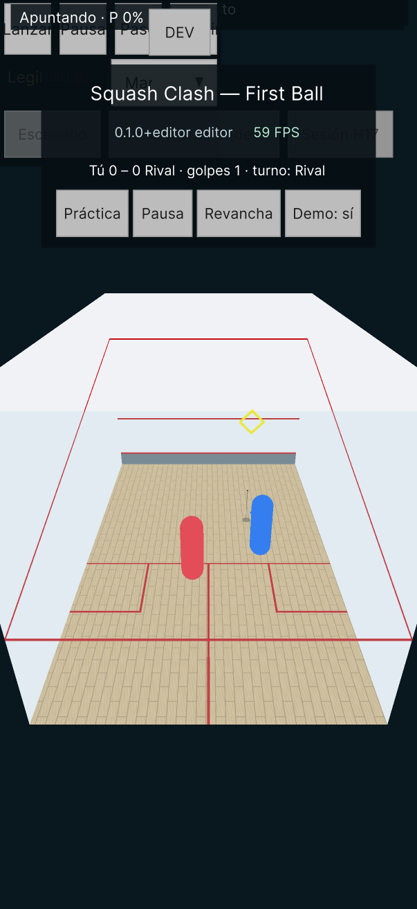
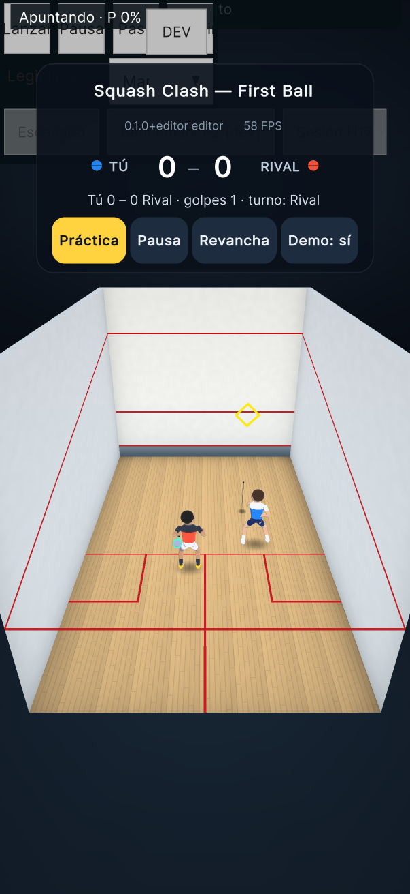
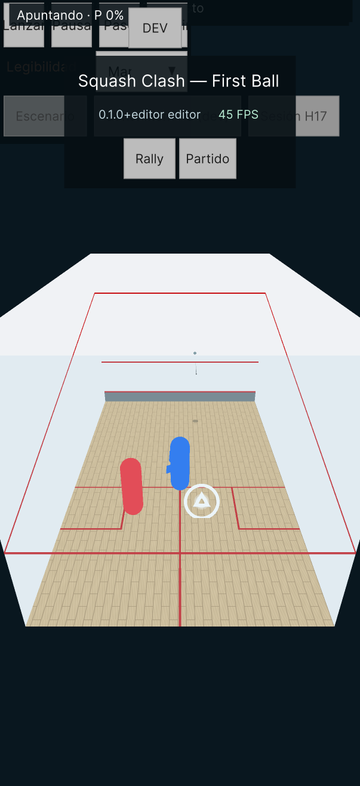
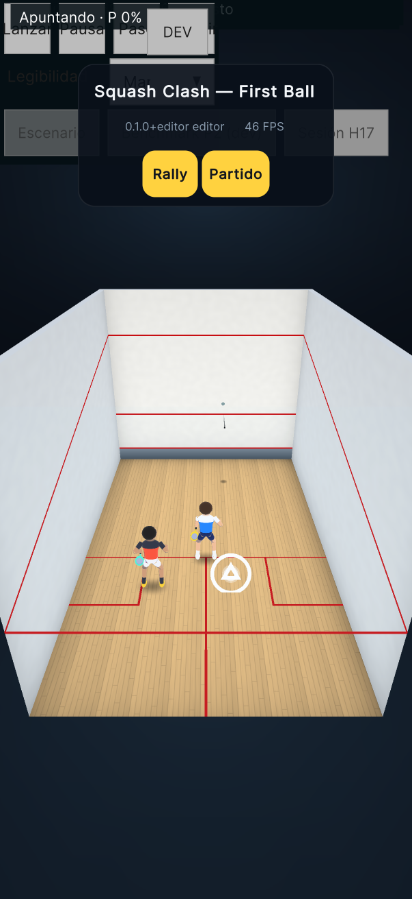
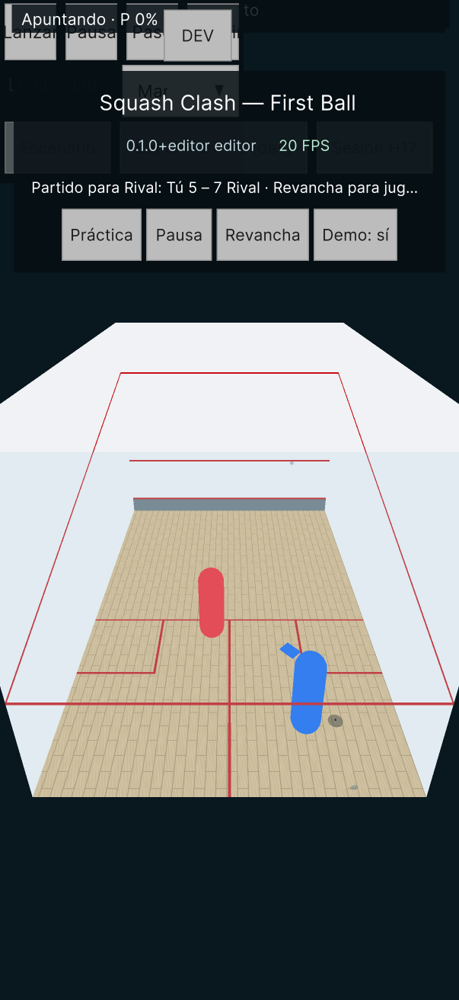
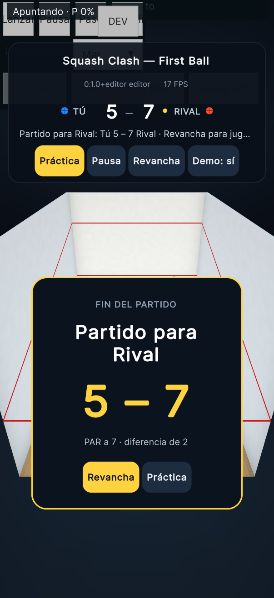

# Pase visual — informe de la entrega

Rama `visual/art-pass`, base `firstrally/gameplay` en `93777e3` (PR #46, borrador). Implementó Claude (Fable) con la [autorización y el plan del 12 de noviembre](2026-11-12-visual-pass-plan.md). PR en borrador, sin fusionar. Sin instalación ni acceso al iPhone.

## Autorización del PO (literal)

> AUTORIZACIÓN: autorizo un pase visual, saliendo del alcance «dirección de arte = FUTURO» solo para esta tarea. Cítala en tu informe. Mi uso de Fable es limitado (cuota de 5 horas): trabaja por bloques en este orden de prioridad, haz un commit por bloque que deje la app funcionando, y si te quedas sin tiempo lo ya entregado debe servir.

**Estado:** los cinco bloques están entregados, cada uno en su commit y con la app funcionando. **Nada está juzgado en el iPhone**: la lectura de la pelota, el movimiento de los personajes y el p95 los decide el PO en el dispositivo. La verificación de esta entrega es por tests, AutoQA, capturas y mediciones en el editor del Mac.

**Nota sobre la base.** El encargo pedía partir de «firstrally/gameplay con la corrección de la regla». Al abrir la rama, `firstrally/gameplay` (local y remota) estaba en `93777e3` y no tenía un commit posterior con esa corrección. Se partió de `93777e3`. Este pase no toca Core ni reglas; integrar la corrección después no debería dar conflictos en los archivos de vista.

## 1. Qué quedó

| Bloque | Commit | Qué hace |
|---|---|---|
| Plan | `1132ba1` | Autorización literal y plan. |
| Captura | `e9a71b0` | Fixture `ZVisualCapture` en ensamblado propio, `scripts/capture.sh` y 17 capturas «antes». |
| 1. Personajes | `cab9a68` | `CharacterView`: figura de piezas con camiseta de dos colores, animada por código. |
| 2. Cancha | `9015347` | Texturas procedurales con la luz horneada, paredes laterales más frías, tin graduado, vidrio trasero menos lechoso, entorno sobrio. |
| 3. Pelota | `796c010` | Halo oscuro suave, sombra difusa, estela algo más ancha. Radio físico de 20 mm intacto. |
| 4. Impactos | `ac49df9` | `ImpactFx`: polvo en botes, onda en paredes, temblor sutil de cámara solo en golpes fuertes. |
| 5. HUD | `96ec780` | Hoja de estilos única, fila de marcador, tarjeta de resultado del partido. |

Código nuevo en `Assets/SquashClash/Runtime/Visual/` (tres clases) y `Assets/SquashClash/Runtime/Resources/Visual/` (dos shaders y una hoja de estilos). No se agregó ningún asset importado: mallas, texturas y materiales se generan en código.

### Qué se tocó fuera de los archivos nuevos

| Archivo | Cambio |
|---|---|
| `PlaceholderPlayers.cs` | Crea la figura bajo `Human` y `Rival`. Conserva `Place`, `Human`, `Rival`, `Apply` y los nombres. La cápsula de 1,80 m sigue existiendo como volumen de referencia, pero ya no se dibuja. |
| `SwingView.cs` | Solo presentación: el brazo y la raqueta se dibujan con mallas nuevas, la cara de la raqueta mira hacia la cámara y hay tres ganchos de lectura (`ShoulderSign`, `ShoulderAnchor`, `Repose`). Poses, fases, tiempos y `RacketLocalPosition` no cambian. |
| `CourtView.cs` | Materiales con texturas procedurales y un nodo `Decor`. Las cinco superficies, las doce líneas y el tin conservan nombre y geometría. |
| `BallView.cs` | Material nuevo y halo. La escala y `ApplyVisualScale` no cambian. |
| `LegibilityAids.cs` | Malla de la sombra con borde difuso, tamaño y opacidad de la sombra, ancho de la estela. El shader `Legibility` no se tocó. |
| `CourtCameraRig.cs` | `Shake` y `TickShake`. Sin temblor en curso, la cámara se comporta igual que antes. |
| `RallyHud.cs` | Estilos por clase, fila de marcador y tarjeta de resultado. Nombres y textos de estado iguales. |
| `AppBootstrap.cs` | Una línea: crea `ImpactFx`. |

**No se tocó:** Core (incluido `Core/Rally`), física, reglas, spec, escenarios, umbrales, criterios, `RallyDirector`, `MatchScore`, `FondoAi`, `RallySim`, `DefaultPreset.json`, `ParamCatalog`, `TimingRingView`, `ImpactCue`, claves `timing.*`, contrato de contacto, reloj, compensación de latencia, shader `Legibility`, `PerfectFlashView`, `ShotFeedback`, `AGENTS.md`, el documento de aprobaciones ni `device.env` (se copió sin cambios al worktree, como permite `AGENTS.md`).

## 2. Verificación

Suites completas y AutoQA en un worktree de verificación aparte, sobre cada commit de bloque:

| Commit | EditMode | PlayMode | AutoQA |
|---|---|---|---|
| Bloque 1 `cab9a68` | 676/676 | 395/396 (falla el test intermitente conocido) | PASS / 0 / nivel 1 |
| Bloque 2 `9015347` | 676/676 | 395/396 dos veces (el mismo test) | PASS / 0 / nivel 1 |
| Bloque 4 `ac49df9` (incluye el 3) | 676/676 | **399/399** | PASS / 0 / nivel 1 |
| Bloque 5 `96ec780` | 676/676 | **400/400** | PASS / 0 / nivel 1 |
| Final `62e2f4f` | 676/676 | **400/400** | PASS / 0 / nivel 1 |

El bloque 3 (`796c010`) no tuvo corrida completa propia: se verificó con sus tests focales (28/28) y quedó cubierto por la corrida completa del bloque 4.

Tests nuevos, todos con prefijo `Z`: `ZCharacterViewTests` (3), `ZImpactFxTests` (3) y un caso más en `ZRallyHudTests`. PlayMode pasa de 393 a 400 casos; EditMode sigue en 676.

**Desviación de TDD, declarada.** Los tests de las vistas nuevas se escribieron después del código, no antes. No hubo un RED por aserción previo a cada implementación. Dos de los tests de `ZImpactFxTests` sí fallaron por aserción en su primera corrida, pero por errores del propio test (contaba hijos ajenos; pedía dos golpes en una misma recepción), que se corrigieron sin tocar el producto.

### El test intermitente de rollback

`ShotRollbackTests.ApplyShot_AfterFlightStopped_ResimulatesToRealPresentViaClockMap` falló en las tres primeras corridas completas y pasó en las siguientes. No lo toqué: es de la zona de timing.

- **Qué pasó.** En esas tres corridas yo estaba ejecutando capturas con otro Unity en paralelo. La suite completa tardó 118 s (en la base, 93 s) y el test arrancó 88 s después del primero, dentro de la banda de 64–128 s en la que falla.
- **Costo mío que sí encontré y corregí.** La textura del piso se generaba en cada construcción de la cancha, es decir, en cada carga de `Main` de cada test. Ahora las texturas de la cancha se generan una vez por proceso (`ac49df9`).
- **Después.** Con las texturas en caché y sin capturas en paralelo: 399/399.
- **Sigue siendo un riesgo.** Cualquier cosa que retrase los fixtures anteriores vuelve a meterlo en la banda. La corrección de fondo es de Codex, como ya dice el informe de First Rally.

### Un cierre inesperado de Unity, una sola vez

La primera corrida de tests después de agregar la hoja de estilos terminó con un fallo de segmento de Unity dentro del generador de texto de UI Toolkit (`UITKTextJobSystem` / `TempMeshAllocator`), sin XML. No se repitió en las corridas siguientes de los mismos fixtures ni en las corridas completas. No tengo una causa demostrada: puede ser la primera importación de la hoja o un fallo propio de Unity. Si aparece en el iPhone o vuelve a aparecer en el Mac, el primer sospechoso es `Hud.uss` (negrita y espaciado de letras).

## 3. Capturas

`scripts/capture.sh <conjunto> [directorio]` ejecuta el fixture `ZVisualCapture` sin `-nographics` y guarda PNG de la escena real (cámara y UI Toolkit) a 1206×2622 reducidos a la mitad (603×1311). Vive en el ensamblado `SquashClash.Capture`, que no corre con `scripts/test.sh` ni con AutoQA y no entra en los Players. El rally se avanza paso a paso (dos pasos de física por frame) con semilla fija, así que «antes» y «después» muestran los mismos instantes simulados.

Carpetas: [`docs/visual/2026-11-12-art-pass/before`](../visual/2026-11-12-art-pass/before) y [`after`](../visual/2026-11-12-art-pass/after). 17 capturas por conjunto: práctica (2), rally en Demo (13, incluidos los golpes de cada jugador y el fin del punto) y partido (saque y resultado).

| Antes | Después |
|---|---|
|  |  |
|  |  |
|  |  |
|  |  |

Las capturas son del editor: muestran la barra DEV encima de la cabecera, que en prod no existe.

### Autorrevisión

**Mejoró**

- **Personajes.** Se leen como dos jugadores de espaldas, con camiseta de dos colores (azul y blanco; rojo y carbón), pantalón, zapatillas y raqueta. El contraste entre ambos es claro aun cuando se cruzan.
- **Cancha.** Pasó de planos de color a una caja iluminada: piso de tablas con una zona más clara al centro, juntas oscuras donde el piso toca las paredes, laterales algo más frías que el frontis. Las líneas rojas resaltan más porque desapareció el velo del vidrio.
- **Vidrio trasero.** El tinte bajó de 25 % a 7 %. Antes lavaba toda la imagen hacia el celeste, incluida la pelota; ahora el contraste general es mayor.
- **Entorno.** El fondo dejó de ser un color plano: piso de sala oscuro, telón con un resplandor suave y tapas en lo alto de las paredes.
- **HUD.** Marcador grande con los colores de las camisetas, botones con estados de pulsado y deshabilitado, acción principal en amarillo, tarjeta de resultado con Revancha y Práctica.

**Sigue mal o flojo**

1. **La pelota sigue siendo muy chica.** Es su tamaño físico (40 mm) visto desde la cámara aprobada: unos 6–8 píxeles en el iPhone. El halo la agranda poco. En las capturas a media resolución casi no se distingue del extremo de la estela. No cambié `aids.ballVisualScale`, que es una decisión tuya ya tomada.
2. **La raqueta del humano se ve poco en el contacto.** Queda de canto o tapada por el cuerpo cuando el contacto es por delante. El brazo de la raqueta del humano es un solo segmento que se estira hasta la empuñadura; no tiene codo.
3. **Los dos jugadores son ambidiestros.** La raqueta pasa al hombro del lado del golpe. Es la convención que ya traía `SwingView`; se lee bien a distancia de juego, pero no es squash real.
4. **Animación simple.** No hay giro del cuerpo al cambiar de dirección ni carrera hacia atrás distinta de la carrera hacia adelante. A velocidad máxima la zancada puede verse larga.
5. **Las figuras no tienen cara.** Desde esta cámara casi nunca se vería, pero en una repetición o un menú harían falta.
6. **La cabecera creció una fila** (el marcador). Sigue por encima de la cancha, pero ya ocupa casi todo el espacio libre sobre ella: no cabe otra fila. El texto de estado del partido terminado se corta con puntos suspensivos, igual que antes.
7. **Los efectos de impacto no se aprecian en capturas fijas.** Duran 0,26–0,30 s. Los cubren los tests, no las imágenes. Hay que mirarlos en movimiento.
8. **El vidrio casi no se nota.** Ganó contraste a costa de la sensación de que hay una pared trasera. La línea de out trasera sigue marcándola.

## 4. Mediciones en el editor

`scripts/capture.sh <conjunto> <directorio> ZVisualPerf` corre un rally en Demo durante 20 s de tiempo real, sin tope de FPS, y escribe `perf-<conjunto>.json`. Mac del PO, editor en modo batch con gráficos, destino de render 1206×2622. Una corrida por lado, sin otro Unity en paralelo. Datos en [`docs/visual/2026-11-12-art-pass/perf`](../visual/2026-11-12-art-pass/perf). **No es el iPhone**: el editor corre a unos 2000 FPS y lo que se mide es el trabajo del hilo principal por frame, no la GPU ni la espera de presentación. Sirve para comparar antes y después en la misma máquina, no para predecir el p95.

| Medida | Antes (`1132ba1`) | Después (`96ec780` + comentario) |
|---|---|---|
| Frames en 20 s | 46 598 | 36 331 |
| Frame medio | 0,43 ms | 0,55 ms |
| Frame p50 | 0,39 ms | 0,40 ms |
| Frame p95 | 0,51 ms | 0,81 ms |
| Frame p99 | 3,10 ms | 3,81 ms |
| Batches (promedio / máximo) | 26,8 / 28 | 58,0 / 60 |
| SetPass (promedio) | 6,8 | 9,6 |
| Triángulos (promedio) | 1 601 | 4 235 |
| Renderers en escena | 31 | 64 |
| Memoria gestionada asignada en los 20 s | 401 MB | 372 MB |
| Colecciones gen0 en los 20 s | 5 | 4 |
| Pose de las dos figuras, por frame | — | 5,2 µs, 0 B |

**Lectura.** El pase tiene un costo real, aunque pequeño, en el hilo principal: el frame medio del editor sube de 0,43 a 0,55 ms (+0,12 ms) y el p95 de 0,51 a 0,81 ms (+0,30 ms). La causa visible son 31 draw calls más (dos figuras de unas 15 piezas cada una, más la raqueta, las sombras de contacto y el entorno) y 2,6 veces más triángulos. Los SetPass suben poco (6,8 a 9,6) porque casi todo comparte un material. El cálculo de las poses es despreciable (5 µs por frame para las dos figuras) y no asigna memoria.

La memoria gestionada no crece: en los mismos 20 s se asignaron 372 MB después y 401 MB antes. Esa asignación de fondo, de unos 19–20 MB por segundo, ya está en la base cuando corre en el editor. No investigué su origen ni sé si existe en el dispositivo; vale la pena mirarla en el iPhone, porque no es de este pase pero sí afecta al p95.

**No puedo decir desde el Mac si esto mueve tu p95 en el iPhone**, que está a 0,1–0,5 ms del umbral. Hay que medirlo. Si empeora, el orden para recortar está en §7.

Decisiones de costo, por diseño:

- **Sin luces ni sombras en tiempo real.** Todo es unlit. El shader `Toon` simula una luz fija con un producto escalar; las sombras de contacto son un quad con una textura difusa.
- **Sin postprocesado.**
- **Sin asignaciones por frame** en `CharacterView`, `ImpactFx`, el temblor de cámara ni el HUD (el marcador solo reescribe texto cuando cambia un valor).
- **Un material opaco compartido** para todas las piezas de las figuras y las raquetas, compatible con el SRP Batcher.
- **Transparencias nuevas, todas pequeñas:** dos sombras de contacto, el halo de la pelota y hasta diez efectos de impacto de vida corta. Se eliminó en cambio buena parte del costo visual del vidrio (sigue siendo un quad transparente a pantalla casi completa, como antes; solo cambió su opacidad).
- **Costo de arranque:** las texturas de la cancha (la del piso es de 512×1024) se generan una vez por proceso. No medí ese tiempo en el iPhone.

## 5. Decisiones tomadas

| # | Decisión | Razón |
|---|---|---|
| 1 | Partir de `93777e3`. | La corrección de la regla no estaba en la rama. |
| 2 | Captura en un ensamblado aparte, con avance determinista. | No altera el recuento de los gates y permite comparar los mismos instantes. |
| 3 | Estilo: cartoon plano, sin luces en tiempo real. | Es lo más barato que se ve bien; tu p95 ya está en el límite. |
| 4 | Figuras hechas de piezas, posadas por código con IK de dos huesos; sin rig, Animator ni assets. | No hay herramienta de modelado en esta entrega y así el costo es conocido y sin asignaciones. |
| 5 | La zancada avanza con la distancia recorrida, no con el tiempo. | Los pies no patinan y la figura se congela sola con la pausa. |
| 6 | La cápsula se conserva sin dibujarse. | Un test existente fija su altura de 1,80 m y sigue siendo el volumen de referencia. |
| 7 | La figura no es más ancha que un jugador con los brazos abiertos (test). | No tapar más pelota que la cápsula aprobada en H1 (caso L5). |
| 8 | El rival prepara la raqueta al plantarse y la lleva al punto del contacto cuando llega el evento. | `RivalSwing` avisa en el instante del contacto; sin preparación previa el golpe se vería tarde. |
| 9 | Ambidiestros, por ahora. | Es la convención de lado que ya usa `SwingView`; cambiarla es tocar más que presentación. |
| 10 | Líneas rojas, sin cambio de color. | Es el color del squash y ya contrasta con pared y piso; lo que les quitaba contraste era el vidrio. |
| 11 | Vidrio trasero al 7 %. | Era un velo sobre toda la imagen. Mejora la lectura de la pelota, no la empeora. |
| 12 | Laterales más frías que el frontis. | Ayuda a leer la profundidad sin sombras reales. |
| 13 | La pelota sigue negra y plana. | Es tu indicación y es su mayor contraste contra pared y piso claros. |
| 14 | Probé un contorno blanco para la pelota y lo dejé fuera, sin prueba en el dispositivo. | Contra las paredes blancas no se ve, y en un punto de pocos píxeles compite con el núcleo negro. Quedó un halo oscuro. Vale la pena volver a probarlo en el iPhone. |
| 15 | Sin destello en el golpe de raqueta. | El destello es hoy exclusivo de Perfect, y «contraste y destello de Perfect» es una condición abierta de S3. Un destello nuevo la confundiría. |
| 16 | Temblor solo si la pelota sale a 0,8·`shot.vMax` o más; 2,8 cm, 0,18 s, sin rotación. | «Sutil y solo en golpes fuertes». Vuelve exactamente a la pose (test). |
| 17 | Sin velo oscuro detrás de la tarjeta de resultado. | Ahorra una mezcla a pantalla completa y en la captura salía casi opaco. |
| 18 | Ninguna clave nueva en `DefaultPreset.json`. | Zona protegida; los valores del pase son constantes en código. |
| 19 | Textos del HUD sin cambios. | Los tests los fijan y son contenido, no presentación. |
| 20 | Los tests de las vistas se escribieron después del código. | Desviación declarada en §2. |

## 6. Claves que pediría (no agregadas)

Si quieres ajustar el pase desde el panel, harían falta estas claves. Agregarlas cambia el hash que AutoQA tiene anclado, así que es una decisión tuya y trabajo de Codex.

| Clave sugerida | Para qué | Valor actual en código |
|---|---|---|
| `visual.cameraShake` | Apagar o graduar el temblor. | 0,028 m; umbral 0,8·`shot.vMax` |
| `visual.impactFx` | Apagar polvo y ondas. | Encendidos |
| `visual.ballHalo` | Tamaño del halo en diámetros de pelota. | 2,3 |
| `visual.glassTint` | Opacidad del vidrio trasero. | 0,07 |

## 7. Qué decide el PO

1. **Instalar la build dev** para el playtest, antes del 18 de noviembre (§9).
2. **El p95 en el iPhone.** Si empeora, lo primero a apagar es el temblor y los efectos de impacto; lo segundo, las figuras (volver a la cápsula es una línea).
3. **Tamaño de la pelota.** Si sigue costando verla, la palanca es `aids.ballVisualScale`, que ya existe.
4. **Vidrio trasero al 7 %**: ¿se mantiene o prefieres más presencia de la pared?
5. **Ambidiestros** y brazo sin codo del humano: ¿vale la pena otra pasada?
6. **Las cuatro claves** de §6.
7. **Fusionar o no.** Nada se fusiona sin tu aprobación.

## 8. Checklist de playtest en el iPhone

Usa **Demo** para mirar sin depender del timing.

Pelota
- [ ] ¿Se lee mejor la pelota que antes contra el frontis? ¿Y contra el piso?
- [ ] ¿La pierdes cuando pasa por delante o por detrás de un jugador?
- [ ] ¿La sombra en el piso te ayuda a leer la altura? ¿Y la estela, la dirección?
- [ ] L1–L6 con DEV cerrado: ¿sigues distinguiendo altura y profundidad como en H1?

Personajes
- [ ] ¿Se entiende a primera vista cuál eres tú (azul) y cuál es el rival (rojo)?
- [ ] ¿Corren, se plantan y vuelven a la T de forma creíble? ¿Los pies patinan?
- [ ] ¿Se nota que el rival prepara el golpe antes de pegar?
- [ ] ¿El golpe sale del lado correcto? ¿Te molesta que cambien de mano?
- [ ] ¿Tu raqueta se ve en el contacto?
- [ ] ¿Las figuras tapan más pelota que las cápsulas?

Cancha e impactos
- [ ] ¿Se siente más pulido sin perder claridad?
- [ ] ¿Las líneas se leen mejor o peor que antes?
- [ ] ¿Echas de menos el vidrio trasero?
- [ ] ¿Ves el polvo en el bote y la onda en la pared? ¿Distraen?
- [ ] ¿Notas el temblor en los golpes fuertes? ¿Es sutil o molesta?
- [ ] ¿Algún efecto se confunde con el destello de Perfect?

HUD
- [ ] ¿El marcador se lee de un vistazo? ¿El punto amarillo deja claro quién saca?
- [ ] ¿Los botones responden al toque y se ve cuándo están pulsados?
- [ ] ¿La cabecera tapa algo que necesites ver?
- [ ] Al terminar un partido, ¿aparece la tarjeta, y Revancha y Práctica funcionan?

Rendimiento
- [ ] Sesión con DEV cerrado: p95, p99 y frames largos, frente a tu referencia de 17,2 / 16,8 ms.
- [ ] ¿Algún tirón al arrancar la app o al entrar al rally?

## 9. Build dev

- **Verificación del commit final `62e2f4f`** (el producto de `96ec780` más la corrección de un comentario en `BallView`): 676/676 EditMode, 400/400 PlayMode, AutoQA PASS / salida 0 / nivel 1, con el árbol limpio.
- **`scripts/check-release.sh` OK** desde `62e2f4f` limpio, `gitDirty=false` en dev y prod. Prod contiene solo los módulos `Core` y `Runtime` (sin panel de desarrollador; el HUD del rally vive en `Runtime` y sí va). Dev agrega `DevPanel`. El ensamblado de captura y el framework de pruebas no entran en ningún Player.
- **`scripts/build-ios.sh dev`: BUILD SUCCEEDED.** Etiqueta **`0.1.0+62e2f4f dev`**: `gitDirty=false`, no Development, IL2CPP Release, `SQUASH_DEV`, arm64, firma verificada con `codesign --verify --strict`.
- Los shaders nuevos (`SquashClash/Toon` y `SquashClash/Fx`) compilan para Metal con una variante cada uno, sin errores en el log de la build.
- Perfil incorporado: creado el 2026-11-11T13:50:05Z, vence el **2026-11-18T13:50:05Z** (10:50:05 America/Santiago).
- Ruta: `.claude/worktrees/visual-art-pass/Builds/DerivedData-dev/Build/Products/Release-iphoneos/SquashClash.app`.
- **No se instaló ni se tocó el iPhone.** Para instalar, con tu autorización y desde ese worktree: `scripts/install-ios.sh dev`. Antes, respaldo y cotejo de P0-calib-1, Po-1 y last-active, como en las sesiones anteriores, y comprobar que el perfil sigue vigente.
- Esta build incluye el gameplay de First Rally (PR #46) tal como estaba en `93777e3`, sin la corrección de la regla mencionada en el encargo.
