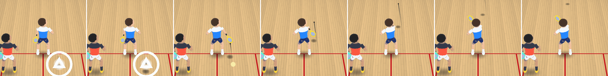
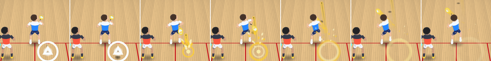
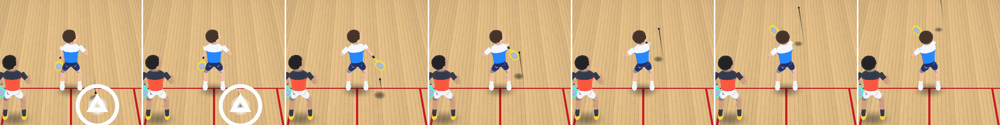
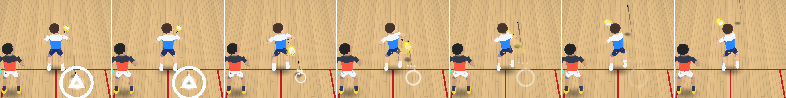
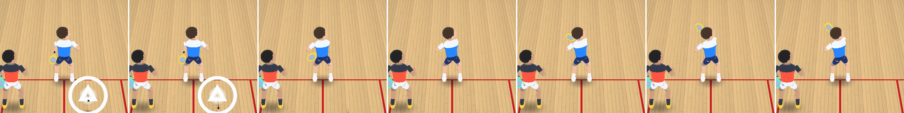
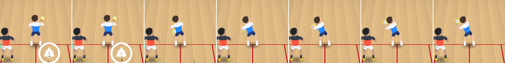

# Segundo pase visual («sensación de juego») — informe

Rama `visual/feel-pass` desde `main` `7fdef02`, [PR #58](https://github.com/rafaallendes-boop/squash-clash/pull/58) en borrador, **sin fusionar ni instalar**. Autor: Claude (Fable). [Plan](2026-11-15-feel-pass-plan.md).

> AUTORIZACIÓN: autorizo un segundo pase visual de «sensación de juego» y golpes más vistosos, sin mecánicas nuevas. Amplío a esta tarea la excepción de dirección de arte que concedí solo para el pase anterior. Cítala en tu informe. […] Objetivo: que dos jugadores peloteando, incluso sin tocar el teléfono, se vean como un partido de squash con golpes que se disfrutan.

(Texto completo en el plan.)

## Qué quedó, por bloque

| Bloque | Commit | Qué cambia | Rojo previo |
|---|---|---|---|
| 0 | `f0b97f2` | El temblor solo existe mientras la cámara se dibuja y espera en pausa. La pose que lee la mira M2-4 nunca se mueve. Solo `CourtCameraRig`. | 2/2 |
| 1 | `3d44ba9` | Vista nueva `StrokeFx`. **Perfect:** doble anillo dorado, abanico de chispas y estela dorada tras la pelota. **Valid:** un anillo blanco y pocas chispas. **Fallido:** sin destello. Tamaño y cantidad crecen con la potencia. Empuje de FOV de 1,6° durante 0,22 s solo en golpes fuertes. | 4/4 |
| 2 | `b591a2d`, `3b489b2` | `CharacterView`: el cuerpo gira hacia donde corre, retrocede con pasos cortos mirando al frontis, se inclina al acelerar, da un paso de ajuste cuando pega el otro. Codo y raqueta de cara a la cámara en ambos jugadores, arco de la raqueta al golpear. La preparación sigue el tirón del dedo, el final crece con la potencia y un golpe al aire se pasa de giro. | 5/5 |
| 3 | `3c7072e` | `RallyHud`: banner sobre el frontis con quién ganó el punto, por qué y quién saca; pulso del dígito; pulso del punto de saque; tarjeta final con resultado y último punto. Solo durante la pausa entre puntos, que no cambia. | 4/4 |
| 4 | — | **Descartado**: marcador de la pelota. Ver decisiones. | — |

## Capturas (`docs/visual/2026-11-15-feel-pass`)

Tiras de siete fotogramas a 50 ms, resolución del iPhone. Antes / después:

| | Antes | Después |
|---|---|---|
| Perfect |  |  |
| Valid |  |  |
| Fallido |  |  |

Rally en Demo: [cancha completa](../visual/2026-11-15-feel-pass/after/21-strip-rally-demo.png), [golpe del rival](../visual/2026-11-15-feel-pass/after/22-strip-rival-stroke.png), [golpe del humano](../visual/2026-11-15-feel-pass/after/23-strip-human-stroke-demo.png), [fin del punto](../visual/2026-11-15-feel-pass/after/15-rally-point-over.png), [fin del partido](../visual/2026-11-15-feel-pass/after/17-match-over.png).

**Mejoró.** El instante del golpe se ve: la raqueta ya no queda de canto, hay arco y destello en el contacto. Perfect y Valid se distinguen por color (dorado contra blanco), por cantidad y por la estela. El fallido se distingue por ausencia de destello y por el cuerpo. Los jugadores esperan con la raqueta arriba, la bajan al volver a la T y dan un paso hacia la pelota. El fin del punto se entiende sin leer la línea de estado.

**Sigue flojo.** (1) La pelota sigue ocupando 6–8 px. (2) El fallido es el más discreto de los tres: depende del cuerpo y de la nota «¡Al aire!». (3) El giro al correr y el retroceso se aprecian en movimiento, no en las tiras; hay que juzgarlos en el teléfono. (4) Los anillos del Perfect fuerte son grandes (hasta 1,4 y 1,6 m de diámetro); pueden sentirse excesivos. (5) El texto de causa es escueto («Tú: doble bote (al aire)»): uso solo los textos de Core. No falta ninguno. (6) Las capturas son del editor y muestran la barra DEV.

## Verificación

**Head final `3b489b2`: 715/715 EditMode, 472/472 PlayMode, AutoQA PASS / salida 0 / nivel 1, `dirty=false`** (corrida `20261115T173223Z-3b489b2-4544`). Cada bloque pasó la misma compuerta sobre su commit (PlayMode 459, 463, 468 y 472); la AutoQA del bloque 0 salió PASS con `dirty=true` por dos ProjectSettings transitorios de PlayMode, que desde entonces restauro antes.

15 pruebas nuevas en cuatro fixtures `Z…`, todas vistas en rojo por aserción antes de implementar (una falló primero por `NullReferenceException`; la reordené y la volví a ver fallar por aserción). En corridas parciales, antes de las compuertas, hubo cuatro fallos y en cada uno corregí la causa sin reintentar: dos defectos de pruebas nuevas (cámara sin destino de render; contaba objetos de otras vistas) y dos errores míos que las pruebas atraparon (con tiempo cero la figura perdía la velocidad, detectado por una prueba existente; el banner se colocaba antes de que creciera la cabecera). Modifiqué una prueba del pase anterior (`ZImpactFxTests`): el temblor ya no mueve el `transform`. Ninguna prueba existente falló en las compuertas. `scripts/check-release.sh` OK sobre `3b489b2` limpio: prod solo con `Core` y `Runtime`.

## Mediciones en el editor (`ZVisualPerf`, rally en Demo, 20 s, Mac del PO)

| Medida | Techo (`perf-after.json`) | Este pase |
|---|---|---|
| Batches, promedio / máximo | 58,0 / 60 | **57,7 / 62** |
| Frame p50 / p95 / p99 | 0,40 / 0,81 / 3,81 ms | 0,40 / 0,51 / 2,11 ms |
| Memoria por frame, promedio | 10 253 B | 10 047 B |
| Vistas nuevas, por tick | — | 0,5 µs, **0 B** |
| Pose de las dos figuras | 5,2 µs, 0 B | 5,6 µs, 0 B |

El promedio queda bajo el techo porque fusioné pelo y cabeza en una malla (sin eso daba 59,7). El **máximo sube de 60 a 62** durante unos 0,3 s de un golpe con todo encendido. La memoria por frame no es cero ni lo era en el techo (asignación de fondo del editor); el pase agrega 0 B. **El p95 del iPhone lo mides tú.** Si empeora, recortar en este orden: estela, arco de la raqueta, chispas.

## Decisiones

1. **Temblor y FOV solo en el render.** No hizo falta tocar la proyección de la mira ni apagar el temblor.
2. **`SwingView`, `ShotFeedback` y `PerfectFlashView` sin editar.** La figura sigue la trayectoria y los tiempos de `SwingView` y dibuja su propio brazo (las dos piezas de `SwingView` dejan de dibujarse). `StrokeFx` escucha la misma entrega única.
3. **Sin deformar la pelota:** cambiar su escala alteraría el diámetro visual de los registros de salto. La estela cumple ese papel.
4. **Fallido sin efecto propio:** la ausencia de destello es la señal.
5. **Valid en blanco y rival en turquesa:** celeste y naranja no contrastaban con la madera.
6. **Banner fuera de la cabecera**, solo con la pelota muerta, y animado con reloj propio (no transiciones USS) para que se congele en pausa.
7. **Marcador de la pelota descartado:** toca la lectura aprobada en H1 y no se puede juzgar sin el teléfono.
8. **Sin claves nuevas** en `DefaultPreset.json`.

Zonas protegidas: no toqué Core, física, `DefaultPreset.json`, los archivos de la PR #56, `GesturePreview`, `TimingRingView`, `RallyDirector`, `AGENTS.md` ni aprobaciones. Fuera de vista solo agregué una línea en `AppBootstrap` para crear `StrokeFx`.

## Build dev

**`0.1.0+3b489b2 dev`, lista y sin instalar.** Exportada desde `3b489b2` limpio (`gitDirty=false`), IL2CPP Release, arm64, no Development, firma verificada con `codesign --verify --strict`. Perfil incorporado: creado el 2026-11-11T13:50:05Z, **vence el 2026-11-18T13:50:05Z (10:50:05 Chile)**; vigente al construir (2026-11-15T17:37Z). Los commits posteriores a `3b489b2` son solo documentación y capturas.

- **Desviación:** `scripts/build-ios.sh dev` exportó bien pero su `xcodebuild` falló porque usa el iPhone como destino y el teléfono no estaba visible para Xcode. Compilé el mismo proyecto exportado con destino genérico de iOS y sin actualizar perfiles en línea, como en la preparación PROD del 4 de noviembre. No modifiqué el script ni toqué el iPhone.
- **Ruta:** `.claude/worktrees/visual-feel-pass/Builds/DerivedData-dev/Build/Products/Release-iphoneos/SquashClash.app`.
- **Para instalar**, con tu autorización y desde ese worktree: `scripts/install-ios.sh dev`. Antes: respaldo y cotejo de P0-calib-1, Po-1 y last-active, y comprobar que el perfil sigue vigente. No reconstruyas con `build-ios.sh` si no hace falta: cambiaría la etiqueta por la del commit de documentación.

## Checklist de playtest en el iPhone

- [ ] ¿Se sienten más vistosos los golpes? Compara uno suave con uno fuerte.
- [ ] ¿Se distingue un golpe perfecto (dorado, con estela) de uno válido (blanco) y de uno fallido (sin destello)?
- [ ] ¿Algún efecto tapa la pelota, la mira o el anillo de timing?
- [ ] ¿Se entiende cuándo golpea cada jugador y cuándo se recupera a la T?
- [ ] ¿Se ve natural el giro al cambiar de dirección y la carrera hacia atrás?
- [ ] ¿La raqueta sigue tu tirón mientras apuntas?
- [ ] ¿Se entiende por qué se ganó o perdió el punto? ¿El banner estorba si apoyas el dedo en la pausa?
- [ ] Pausa justo después de un golpe fuerte: ¿queda todo quieto (cámara, efectos, figuras, banner)?
- [ ] Apoya el dedo justo después de un golpe fuerte del rival: ¿la mira aparece donde tocas?
- [ ] H1 con L1–L6 y DEV cerrado: ¿altura y profundidad se leen igual que antes?
- [ ] p95 con DEV cerrado frente a tu medición anterior.
