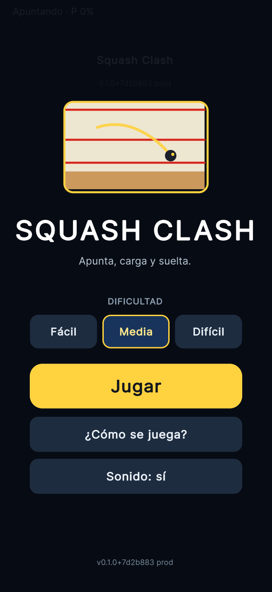
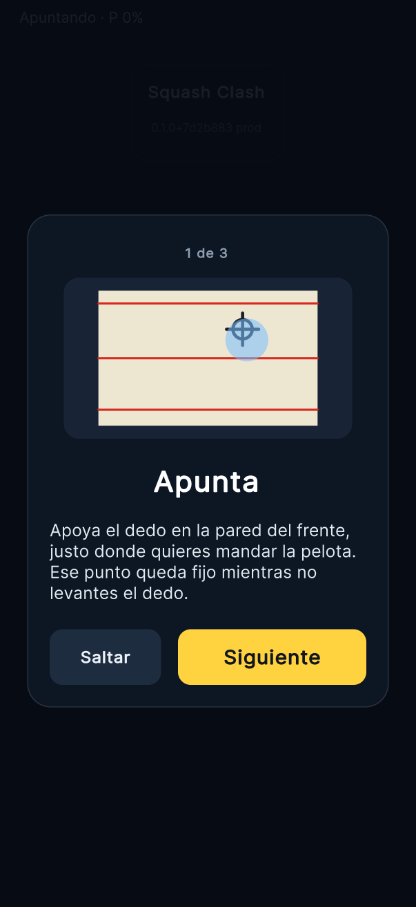
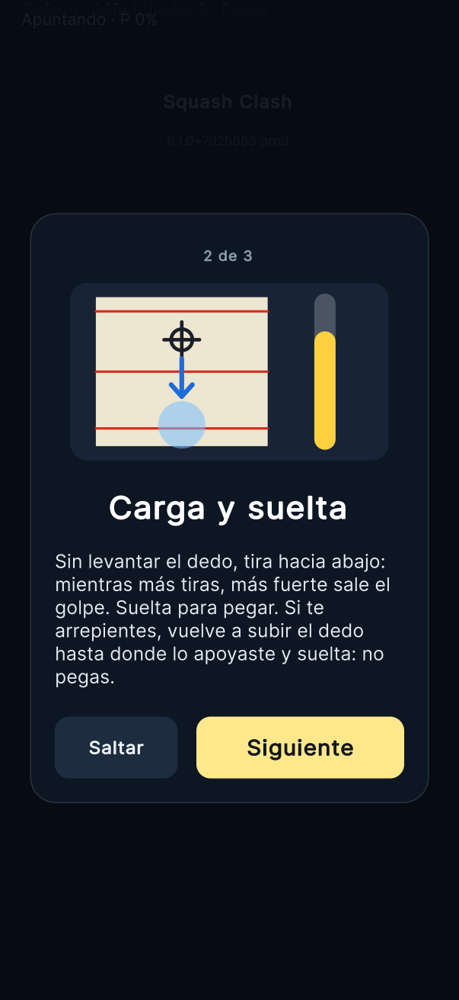
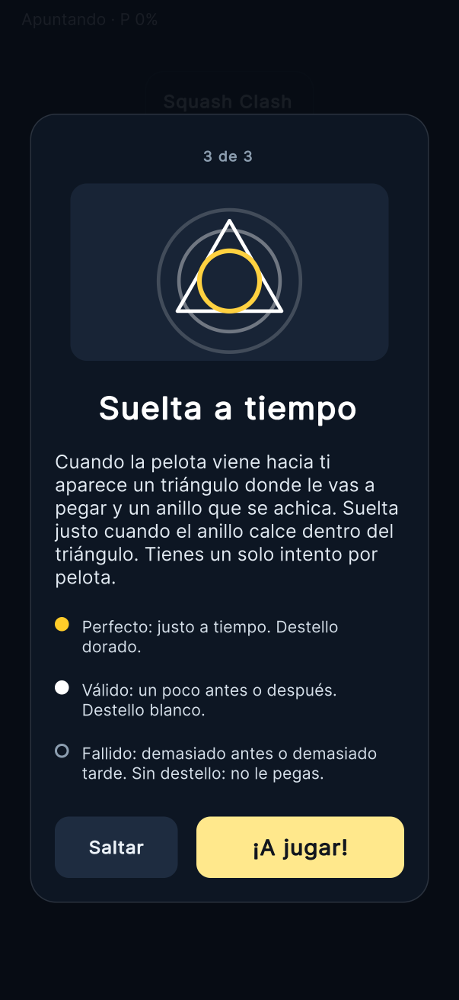
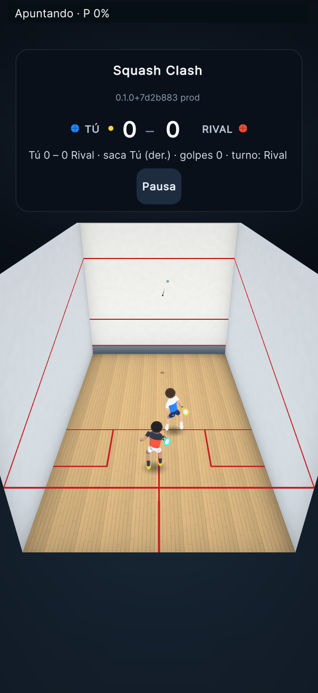
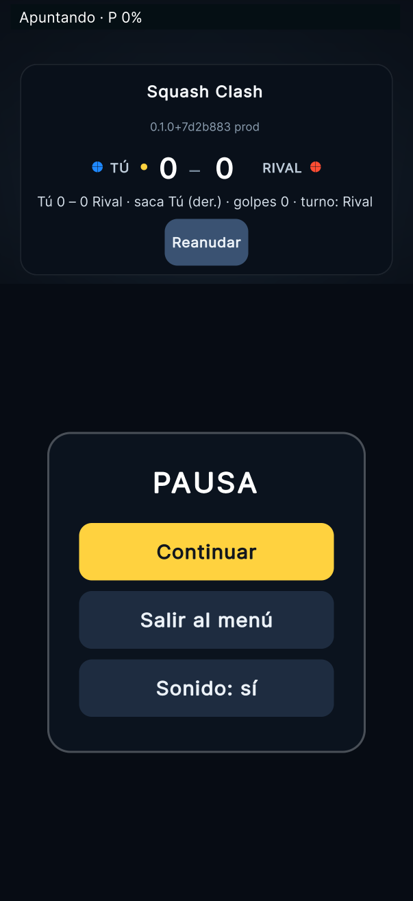
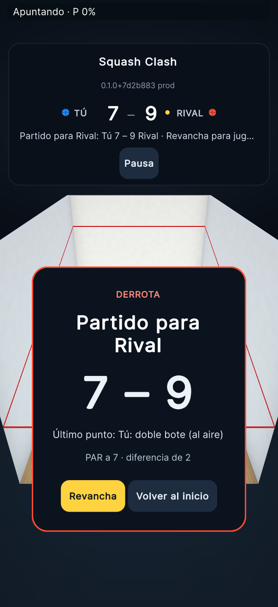
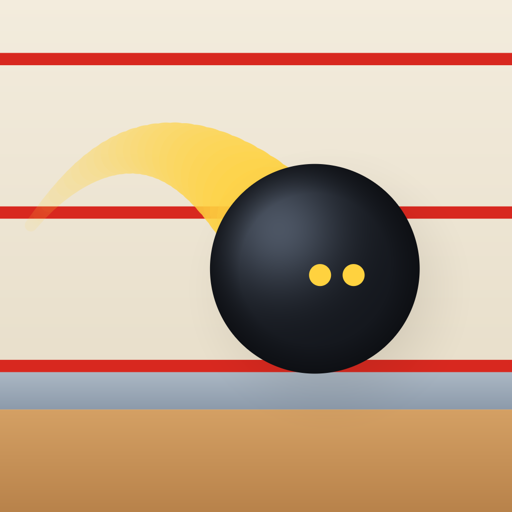
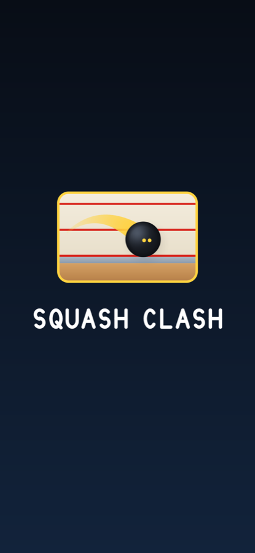

# Primera experiencia — informe

Rama `visual/first-run` desde la punta de `visual/feel-pass` (`a401e2a`, PR #58 sin fusionar). [PR #59](https://github.com/rafaallendes-boop/squash-clash/pull/59) en borrador con base `visual/feel-pass`, **sin fusionar ni instalar**. Autor: Claude (Fable).

> AUTORIZACIÓN (solo para esta tarea): autorizo a Fable a construir la "primera experiencia" de Squash Clash (pantalla de inicio, mini-tutorial, flujo de fin de partido, arte del ícono y de la pantalla de carga) y una capa de sonido ambiental y de partido. Sin mecánicas nuevas.

## Qué quedó, por bloque

| Bloque | Commit | Qué cambia | Rojo previo |
|---|---|---|---|
| A | `26e3e78` | Un lanzamiento normal abre el **menú de inicio** sobre la cancha en pausa: título, Jugar, dificultad (Fácil / Media / Difícil, Media por defecto), «¿Cómo se juega?» y versión. Jugar llama al mismo `StartMatch` del botón «Partido», con el `AiLevel` elegido. En prod desaparecen Rally/Práctica, Demo, Revancha de la cabecera, Partido, FPS y el título «— First Ball». | 8/8 |
| B | `b790e84` | **Tutorial** de 3 pasos, saltable, antes del primer partido; se guarda en PlayerPrefs al terminarlo o saltarlo y se reabre desde el menú. Texto según `M24Model` y `TimingRingView`: el dedo fija la mira donde se apoya, tirar hacia abajo carga, soltar pega, volver a subir cancela; anillo que calza en el triángulo; Perfecto / Válido / Fallido. | 5/5 |
| C | `271c9db` | **Pausa** con Continuar y Salir al menú. **Fin de partido** con Revancha y Volver al inicio («Práctica» queda solo en dev). | 4/4 |
| D | `53141e9` | `scripts/art/make_release_art.py` (solo biblioteca estándar) escribe en `Assets/SquashClash/Art/Release/` el **ícono** 1024×1024 y la **pantalla de carga** 1290×2796, PNG RGB sin canal alfa ni esquinas redondeadas, reproducibles byte a byte. No toqué ProjectSettings ni Info.plist. | 3/3 |
| E | `7d2b883` | Vista nueva `AudioScape` y `scripts/audio/make_audioscape.py`: bote en piso, paredes, frontis, pasos y raqueta del rival, punto ganado y perdido, clic de botones y ambiente de cancha. Interruptor «Sonido» en menú y pausa. | 11/12 |
| — | `0d58aeb` | Prueba de 0 B por refresco del flujo del menú. | guarda |

## Capturas ([carpeta](../visual/2026-11-15-first-run))

| Menú (prod) | Tutorial 1 | Tutorial 2 | Tutorial 3 |
|---|---|---|---|
|  |  |  |  |

| Partido (prod) | Pausa | Fin de partido | Ícono y carga |
|---|---|---|---|
|  |  |  |   |

También: [menú en dev](../visual/2026-11-15-first-run/03-menu-dev.png) (con «Práctica (dev)») y [Difícil elegido](../visual/2026-11-15-first-run/02-menu-level-hard.png). Son del editor. **Los velos translúcidos salen opacos en estas capturas**: un velo rojo de prueba al 50 % también salió opaco, y sin velo la cancha en pausa se dibuja bien, así que lo atribuyo al arnés de captura. No lo pude confirmar en el teléfono, donde el velo de pausa (50 %) debería dejar ver la cancha.

## Sonidos agregados (fórmulas y procedencia en [PROVENANCE.md](../../Assets/SquashClash/Runtime/Resources/Audio/PROVENANCE.md))

Bote en el piso (grave y sordo), paredes laterales y trasera (toque medio), frontis (el más lleno), paso del rival (uno cada 0,9 m corridos), raqueta del rival (grave, sin ruido de ataque), punto ganado (dos notas que suben) y perdido (dos que bajan), 0,18 s después del punto, clic de los botones del juego y ambiente de cancha en bucle de 4 s. Cada repetición cambia el tono ±5 % y el volumen va del 60 % al 100 % según la fuerza. Seis fuentes fijas más una de ambiente: no se crea ninguna por evento.

`ShotFeedback`, sus cuatro clips y `LatencyCalibration` no se tocaron. `AudioScape` no se suscribe a la entrega del contacto y sus fuentes viven en un objeto hijo. **Mezcla:** mi primera versión dejaba el bote y el frontis casi tan fuertes como `impact-valid`; agregué una prueba que lo mide y bajé los niveles: ningún sonido de cancha supera la mitad del pico del clip de contacto más bajo (−6 dB). **No puedo oír:** la mezcla está verificada solo con números.

## Verificación

**Head final de código `0d58aeb`, árbol limpio: 735/735 EditMode, 502/502 PlayMode, AutoQA PASS / salida 0 / nivel 1 (`dirty=false`, corrida `20261115T225028Z-0d58aeb-13043`), `scripts/check-release.sh` OK** (prod solo con `Core` y `Runtime`). La misma compuerta pasó sobre `7d2b883`; A y C pasaron EditMode y PlayMode completos sobre sus commits.

33 pruebas nuevas (30 PlayMode, 3 EditMode); 31 vistas en rojo por aserción antes de implementar. Las dos de 0 B no tuvieron rojo: pasan contra un esqueleto vacío. Ninguna prueba existente se modificó ni falló. En corridas parciales corregí la causa sin reintentar: una corrida con 0 pruebas por un error de compilación mío (no la conté como rojo) y dos supuestos errados de pruebas nuevas (preguntaba por la tarjeta de resultado antes de que terminara de aparecer; asumía una sola fuente de audio en el objeto de la app y en dev `LatencyCalibration` agrega la suya).

| Medida (editor, rally en Demo, 20 s) | Pase anterior | Ahora |
|---|---|---|
| Batches, promedio / máximo | 57,7 / 62 | **57,7 / 62** |
| Frame p50 / p95 | 0,40 / 0,51 ms | 0,40–0,50 / 0,52–0,70 ms (dos corridas) |
| Memoria total en 20 s | 421 MB | 412–426 MB |
| Vistas nuevas, por tick | — | **0 B** (2000 ticks de `AudioScape` con solicitudes y 2000 refrescos del menú) |

La medición de 0 B es en batch mode, donde el audio se solicita pero no se reproduce. **El p95 del iPhone lo mides tú.**

## Decisiones y cosas que debes saber

1. **Batch mode conserva el arranque anterior** (directo a práctica): así los 472 PlayMode y AutoQA no cambian. Las pruebas del menú activan el arranque normal con `FirstRunFlow.OpenAtBoot`.
2. **Línea técnica en prod.** `GesturePreview` (protegido) sigue mostrando «M2-4 · Tensando · P 34 % · …» también en prod. No lo toqué. Puedo ocultarla en prod con una regla de estilo, sin editar ese archivo, si lo decides.
3. **«Sonido» silencia todo el juego** (volumen del oyente): también el contacto del jugador y el clic de la calibración de latencia. Se recuerda entre lanzamientos. Los hápticos no cambian.
4. **Silencio en pausa:** se callan la cancha y el ambiente; el clic de botones sí suena, porque los menús solo existen en pausa.
5. La tarjeta de pausa aparece solo con el botón Pausa del jugador, no con la pausa de DEV ni con la del sistema.
6. La dificultad no se recuerda entre lanzamientos: parte en Media.
7. La raqueta del rival suena hasta un frame después de su contacto, igual que su destello.
8. El arte no está conectado: eso es del carril de release.
9. Zonas protegidas: no toqué Core, física, `DefaultPreset.json`, timing, contrato de contacto, reloj, `GesturePreview`, `TimingRingView`, `SwingView`, `AGENTS.md` ni aprobaciones. Fuera de los archivos nuevos edité `AppBootstrap`, `RallyHud`, `Hud.uss` y `PROVENANCE.md`.

## Build dev

**`0.1.0+0d58aeb dev`, lista y sin instalar.** Exportada desde `0d58aeb` limpio (`gitDirty=false`), IL2CPP Release, arm64, no Development, `codesign --verify --strict` conforme. Perfil incorporado: **vence el 2026-11-18 a las 10:50:05 de Chile**; vigente al construir (2026-11-15T22:55Z). Los commits posteriores son solo documentación y capturas.

- **Desviación, igual que en el pase anterior:** exporté con el mismo método de `scripts/build-ios.sh dev` y compilé con destino genérico de iOS, sin actualizar perfiles en línea, para no consultar el iPhone. No modifiqué el script.
- **Ruta:** `.claude/worktrees/visual-first-run/Builds/DerivedData-dev/Build/Products/Release-iphoneos/SquashClash.app`.
- **Para instalar**, con tu autorización y desde ese worktree: `scripts/install-ios.sh dev`, con respaldo y cotejo previo de P0-calib-1, Po-1 y last-active. No reconstruyas con `build-ios.sh`: cambiaría la etiqueta. La build es dev: verás el menú con «Práctica (dev)»; lo que ve un compañero es la variante prod de las capturas.

## Checklist de playtest en el iPhone

- [ ] Abre la app: ¿aparece el menú y se entiende qué tocar? ¿La versión se lee abajo?
- [ ] Primer Jugar: ¿el tutorial se entiende en un minuto? ¿Describe bien el gesto que haces con el dedo?
- [ ] Segundo Jugar: ¿entra directo al partido? ¿«¿Cómo se juega?» lo reabre y vuelve al menú?
- [ ] Juega un partido en cada dificultad: ¿se nota la diferencia?
- [ ] Pausa: ¿se ve la cancha detrás del velo? ¿Continuar retoma sin saltos? ¿Salir al menú deja el marcador en cero al volver a jugar?
- [ ] Fin de partido: ¿funcionan Revancha y Volver al inicio?
- [ ] ¿Algún menú deja pasar un toque a la cancha o queda visible durante el juego?
- [ ] Sonido: ¿suena a squash? ¿Algo tapa o se confunde con tu golpe (Perfect y Valid)?
- [ ] ¿Se distinguen piso, pared y frontis? ¿Cansan los pasos del rival o el ambiente tras varios puntos?
- [ ] ¿Punto ganado y perdido se distinguen sin mirar? ¿El clic de botones molesta?
- [ ] «Sonido: no» en el menú y en la pausa: ¿queda todo en silencio y se recuerda al reabrir la app?
- [ ] Con el interruptor de silencio del teléfono: ¿se comporta como esperas?
- [ ] La línea «M2-4 · …» de abajo: ¿la dejo o la oculto en prod?
- [ ] p95 con DEV cerrado frente a tu medición anterior.
