# Robustez de dispositivos, música y opción para zurdos — informe

Rama `visual/device-robustness` desde la punta de `visual/first-run` (`98befb1`; #59 no estaba fusionada). [PR #60](https://github.com/rafaallendes-boop/squash-clash/pull/60) en borrador con base `visual/first-run`, **sin fusionar ni instalar**. Autor: Claude (Fable).

> AUTORIZACIÓN (solo para esta tarea): autorizo a Fable a hacer una pasada de robustez en distintos iPhones, agregar música original y una opción cosmética para jugador zurdo. Sin mecánicas nuevas.

## Qué quedó, por bloque

| Bloque | Commit | Qué cambia | Rojo previo |
|---|---|---|---|
| A | `65d1478` | **Zonas seguras.** `SafeAreaLayout` lee `Screen.safeArea` y la aplica como márgenes: el encabezado parte justo bajo el notch o la Dynamic Island (o a 12 unidades del borde en un teléfono sin ellos, en vez de 60 fijas) y menú, tutorial, pausa y tarjeta final quedan sobre la barra inferior. En un iPhone 16 Pro la pantalla queda igual que antes. | 9/18 |
| A | `7659f24` | **Interrupciones.** Botón de inicio, llamada, centro de notificaciones o bloqueo en medio de un partido: el partido se pausa solo **en la tarjeta de pausa** y espera «Continuar», desde el mismo paso de simulación. Menú, tutorial y pausa ya abierta no reciben una segunda capa. El ambiente de cancha se vuelve a pedir si el sistema de audio se reinicia. | 8/10 |
| A | `7a039fe` | Capturas por dispositivo y una guarda sobre los ajustes del proyecto: vertical fijo, solo iPhone, iOS 15, pantalla completa. Ya estaban así; no toqué `ProjectSettings`. | guarda |
| B | `21f6322` `c647cb2` | **Música original.** `scripts/audio/make_music.py` (solo biblioteca estándar, sin samples ni MIDI, reproducible byte a byte) compone un bucle de menú de 19,2 s y uno de partido de 16 s. `MusicPlayer` los cruza con un fundido, calla en pausa y retoma donde iba. Interruptor «Música» junto al de «Sonido», en el menú y en la pausa. | 8/9 |
| C | `6c47efc` | **«Mano: diestro / zurdo»** en el menú, guardada en PlayerPrefs. Con zurdo, la figura sostiene la raqueta siempre en la mano izquierda y cruza el brazo en los golpes del lado derecho. Solo la lee `CharacterView`. | 3/5 |

## Capturas ([carpeta](../visual/2026-11-16-device-robustness)): iPhone SE 375×667 arriba, Pro Max 430×932 abajo

| Menú | Tutorial 3 | Partido | Banner | Pausa | Fin |
|---|---|---|---|---|---|
| 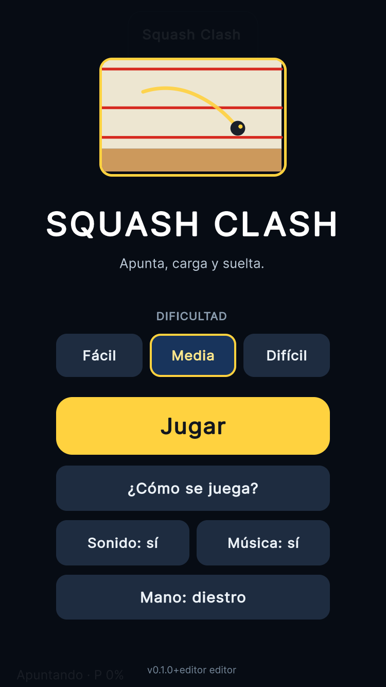 | 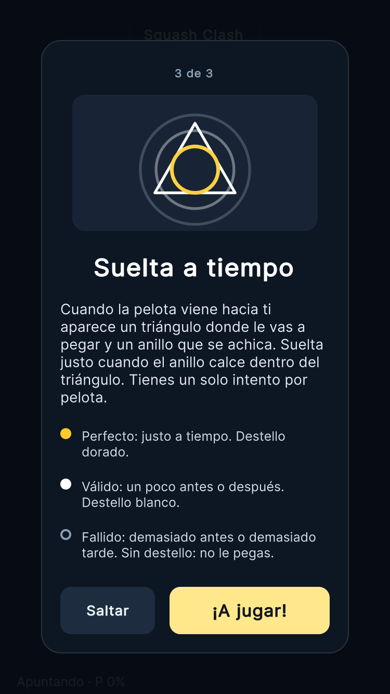 | 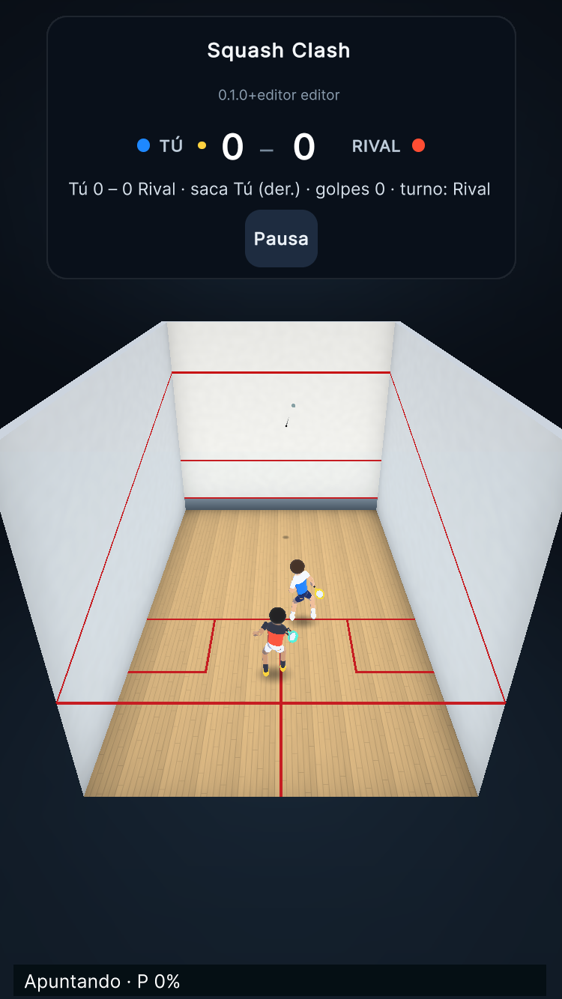 | 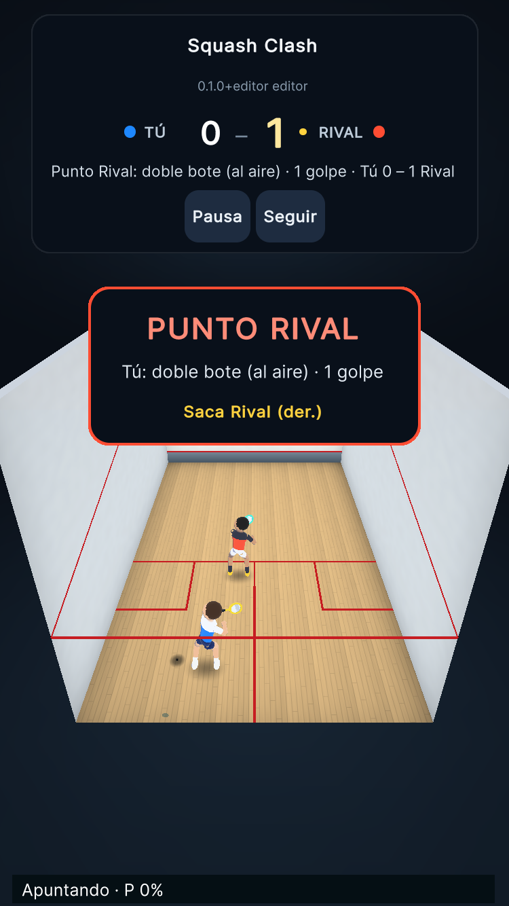 | 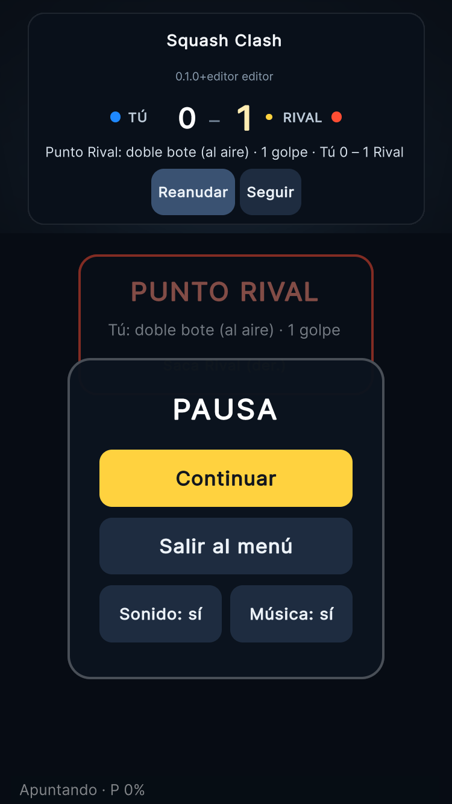 | 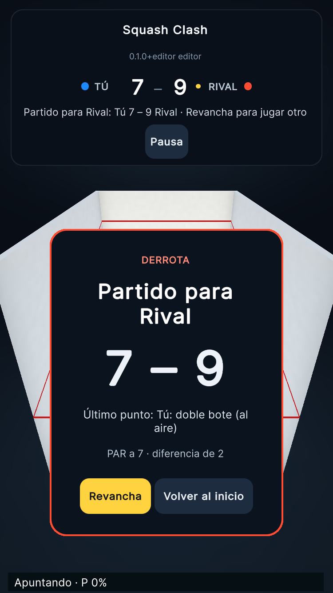 |
| 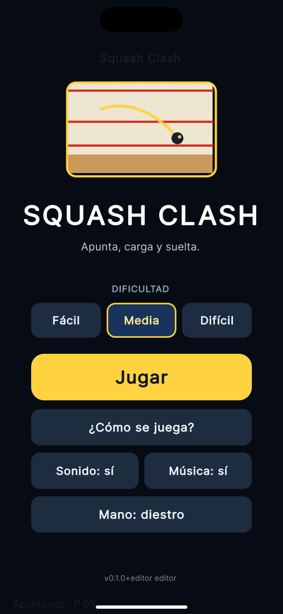 | 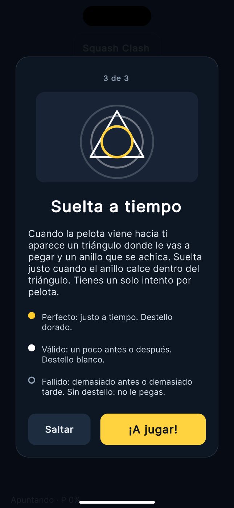 | 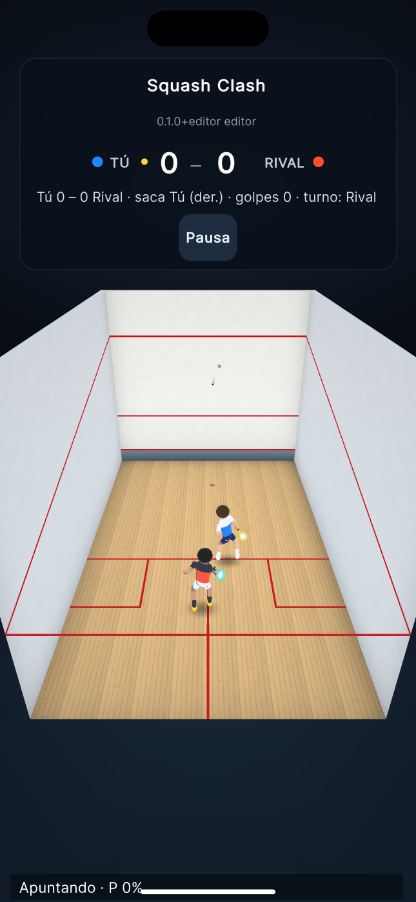 | 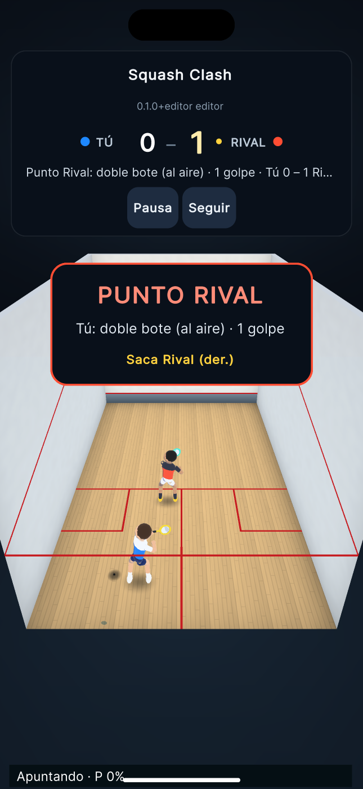 | 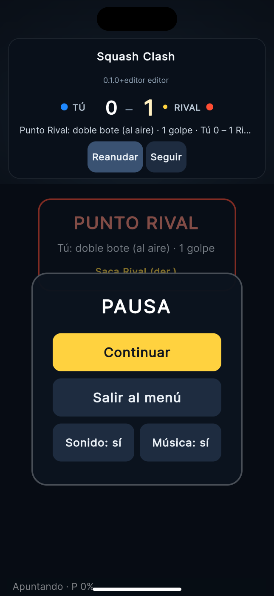 | 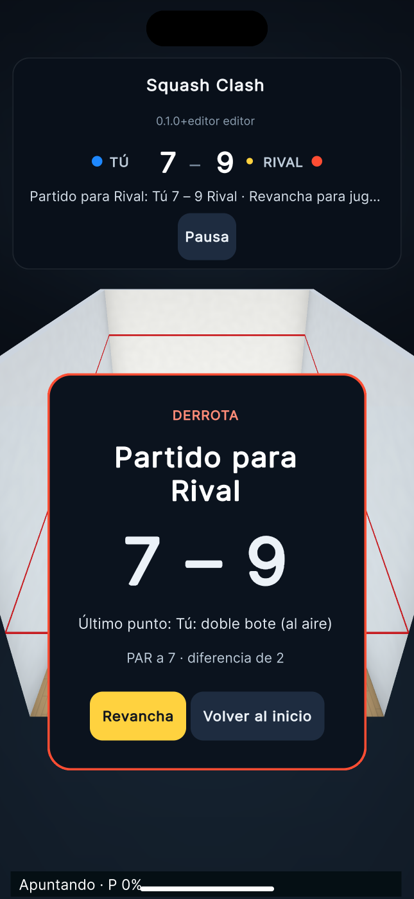 |

También en la carpeta: tutorial 1 y 2 de cada tamaño, y la opción de zurdo ([menú](../visual/2026-11-16-device-robustness/promax-430x932-09-left-handed-menu.png), [golpe de su lado](../visual/2026-11-16-device-robustness/promax-430x932-10-left-handed-near.png), [golpe cruzado](../visual/2026-11-16-device-robustness/promax-430x932-11-left-handed-across.png)). Son del editor, como prod las muestra, con la zona segura de cada teléfono simulada; la isla y la barra inferior están dibujadas encima. Dos salvedades del arnés: los velos translúcidos salen opacos (igual que en first-run) y la línea técnica «Apuntando · P 0 %» aparece sobre la barra inferior porque `GesturePreview` lee la zona segura real del equipo, que no puedo simular sin tocarlo; en el teléfono queda 30 unidades sobre la barra.

## Verificación

**Head final de código `6c47efc`, árbol limpio: 737/737 EditMode, 544/544 PlayMode, AutoQA PASS / salida 0 / nivel 1 (`dirty=false`, corrida `20261116T100627Z-6c47efc-26272`), `scripts/check-release.sh` OK (prod solo con `Core` y `Runtime`).** AutoQA también pasó sobre el bloque A solo (`7a039fe`).

44 pruebas nuevas (42 PlayMode, 2 EditMode): 28 rojas por aserción antes de implementar; las demás son guardas de lo que ya se cumplía (ajuste en pantallas donde ya cabía, práctica sin música, 0 B, mismo partido con y sin zurdo, ajustes del proyecto). Las de ajuste arrancan la escena real en cuatro tamaños (SE 375×667, mini 375×812, Pro 402×874, Pro Max 430×932) y exigen que cada texto y botón quede dentro de la zona segura, sin aplastarse, cortarse ni encimarse. Ninguna prueba existente se modificó. Corregí la causa sin reintentar en cuatro corridas parciales: dos errores de compilación míos (no cuentan como rojo), un botón de la tarjeta final que quedaba en 43,9 unidades al redondearse a píxeles (ahora mide 46) y **la primera versión de zurdo, que ponía la raqueta en la mano derecha**: lo vi en la captura; las pruebas ahora miden la mano en coordenadas del mundo (la pared izquierda está en +x).

| Medida (editor, rally en Demo, 20 s) | first-run | Ahora |
|---|---|---|
| Batches, promedio / máximo | 57,7 / 62 | **57,7 / 62** |
| Frame p50 / p95 | 0,40–0,50 / 0,52–0,70 ms | 0,50 / 0,71 ms |
| Vistas nuevas, por tick | — | **0 B** (2000 ticks de `SafeAreaLayout`, de `MusicPlayer` y de la figura zurda) |

## Decisiones y cosas que debes saber

1. **Una interrupción en pleno partido ya no muestra «Toca para continuar»**: abre la tarjeta de pausa. Práctica, pausas de DEV y fin de partido conservan la capa anterior. Es un cambio de comportamiento; si prefieres el anterior, es una línea.
2. **«Sonido: no» ya no apaga la música**: son independientes (antes «Sonido» silenciaba todo el juego). La música no suena en práctica ni en pausa.
3. **La música no la ha oído nadie.** Está verificada con números: el bucle del partido queda 12 dB o más bajo el contacto más suave y no tiene percusión ni ataques que se confundan con un golpe. Si no te gusta, se apaga con el interruptor y la partitura se cambia en el script.
4. **«Diestro» es la figura de siempre, que lleva la raqueta al lado del contacto** (cambia de mano); «zurdo» la fija en la izquierda. Si quieres que diestro la fije en la derecha, es el mismo código: dímelo. El HUD no necesitó cambios (mira y anillo son simétricos). `gesture.slingPreferLeft` no se toca: las métricas siguen registrando `declaredHand` como antes.
5. **Botones en el SE:** el panel mide 430 unidades de ancho sobre 375 pt, así que un botón de 44 unidades (Pausa, Seguir) mide unos 38 pt. No lo cambié: agrandarlos corre el encabezado sobre el frontis.
6. El título del menú se salía 8 unidades de su caja en pantallas de 390: pasó de 38 a 36 px.
7. En el editor y en las pruebas sin zona segura simulada el encabezado ahora parte a 12 unidades, no a 60.
8. **No verificable sin el teléfono:** llamada, alarma y Siri sobre el audio, audífonos, el interruptor de silencio y la convivencia con música de otra app (la sesión mezcla con ella; detectarla exige código nativo, que no agregué).
9. Zonas protegidas: no toqué Core, física, `DefaultPreset.json`, timing, contrato de contacto, reloj, `GesturePreview`, `TimingRingView`, `SwingView`, `ShotFeedback`, `ResumeOverlay`, `AGENTS.md` ni `ProjectSettings`. Edité `AppBootstrap`, `FirstRunFlow`, `RallyHud`, `AudioScape`, `CharacterView`, `Hud.uss` y `PROVENANCE.md`.

## Build dev

**`0.1.0+6c47efc dev`, lista y sin instalar.** Exportada desde `6c47efc` limpio (`gitDirty=false`), IL2CPP Release, arm64, `codesign --verify --strict` conforme. `Info.plist` de la app: solo `UIInterfaceOrientationPortrait`, solo iPhone, iOS 15.0 mínimo, pantalla completa. Perfil incorporado: **vence el 2026-11-18 a las 10:50:05 de Chile**; vigente al construir (2026-11-16T14:33Z). Los commits posteriores son solo documentación y capturas.

- **Desviación, igual que en first-run:** exporté con el mismo método de `scripts/build-ios.sh dev` y compilé con destino genérico de iOS, sin actualizar perfiles en línea, para no consultar el iPhone. No modifiqué el script.
- **Ruta:** `.claude/worktrees/visual-device-robustness/Builds/DerivedData-dev/Build/Products/Release-iphoneos/SquashClash.app`.
- **Para instalar**, con tu autorización y desde ese worktree: `scripts/install-ios.sh dev`, con respaldo y cotejo previo de P0-calib-1, Po-1 y last-active, y con la sesión completa antes del vencimiento del perfil. No reconstruyas con `build-ios.sh`: cambiaría la etiqueta. Incluye todo lo de #58 y #59.

## Checklist de playtest en el iPhone

- [ ] Menú: ¿todo queda bajo la isla y sobre la barra inferior? ¿La versión se lee?
- [ ] Encabezado en partido: ¿igual que antes en tu teléfono? ¿Tapa algo del frontis?
- [ ] En plena pelota: botón de inicio y volver. ¿Aparece la tarjeta de pausa? ¿«Continuar» retoma el mismo punto, con el mismo marcador?
- [ ] Lo mismo bloqueando la pantalla, bajando el centro de notificaciones y abriendo el centro de control.
- [ ] Con el dedo apoyado apuntando, bloquea la pantalla: al volver, ¿quedó algún golpe fantasma?
- [ ] Recibe una llamada (o pon una alarma) durante un partido: al terminar, ¿vuelven el ambiente, los golpes y la música?
- [ ] Conecta y desconecta audífonos en el menú y en un partido: ¿sigue sonando?
- [ ] Interrumpe en el menú, en el tutorial y con la pausa abierta: ¿vuelve tal como estaba, sin capa extra?
- [ ] Gira el teléfono en cada pantalla: ¿se mantiene vertical?
- [ ] Música del menú: ¿te gusta? ¿El bucle tiene costura? ¿Cansa?
- [ ] Música del partido: ¿se oye apenas? ¿Tapa o se confunde con Perfect, Valid o los botes?
- [ ] «Música: no» con «Sonido: sí», y al revés: ¿cada interruptor apaga solo lo suyo y se recuerda al reabrir?
- [ ] Con otra música sonando (Spotify) y con el interruptor de silencio: ¿se comporta como esperas?
- [ ] «Mano: zurdo»: ¿la raqueta va en la izquierda? ¿Se ve bien el golpe cruzado? ¿Sientes igual el gesto y la mira?
- [ ] ¿Quieres que «diestro» fije la raqueta en la derecha?
- [ ] p95 con DEV cerrado frente a tu medición anterior.
