# Inicio y estética de golpes — informe

Rama `claude/menu-visual` desde `main` `75b9ce8`. **Sin push, PR, fusión ni instalación.** Implementado por subagente Opus dirigido por Claude; la revisión de Claude no es independiente. Encargo del PO: «Mejorar estéticamente con /frontend-design:frontend-design el inicio y la estética de golpes.»

## Dirección

Dos superficies tomadas de la cancha. **Fuera de juego** (inicio, tutorial, pausa, fin) todo es un trozo de la pared frontal: yeso claro, texto tinta y las líneas rojas de la cancha; la acción principal de cada pantalla es rojo de línea. **En juego** (cabecera, cartel de punto, nota de golpe) las superficies son vidrio verde azulado oscuro, como la pared trasera. El amarillo son los dos puntos de la pelota: Perfecto, quien saca, la victoria. Lo memorable está en un solo lugar: el inicio **es** la pared, con la línea de saque cruzando la pantalla y la chapa en el borde inferior; arriba, la pelota con sus dos puntos amarillos entra con estela sobre el logotipo en cursiva.

Tipografía: **Rubik** (Hubert & Fischer, v1.100), una sola familia. Negrita cursiva para lo que se mueve (logotipo, marcador, nota de golpe, títulos, «Jugar»), negrita para controles y nombres, regular para leer. Escala 11 / 12 / 14 / 16 / 18 / 24 / 26 / 28 / 40 / 60. **Licencia: SIL Open Font License 1.1**, confirmada en la tabla `name` del archivo (campos 13 y 14), sin nombre reservado. Texto completo en `Assets/SquashClash/Runtime/Visual/Fonts/OFL.txt`. Origen: copia local de Rubik incluida en una instalación de LibreOffice de la máquina; no se descargó nada.

## Qué cambió (solo presentación)

| Commit | Qué |
|---|---|
| `934e7ec` | Captura: agrega la nota de golpe y el cartel de punto al recorrido de `ZFirstRunCapture`, con barras de energía visibles. |
| `1bd204b` | Rubik regular, negrita y negrita cursiva como `FontAsset` SDF **estáticos** (48 pt, atlas 1024², ASCII + Latin-1 + – — ‘ ’ “ ” … •) y su generador `Editor/RubikFontAssets.cs`. |
| `d87ce4d` | `ZUiLookTests` (5): fuente en cada superficie del jugador, tono y «pop» de la nota, ubicación de la nota, contraste AA. |
| `5b18aef` | `Hud.uss` reescrito con tokens; `FirstRunFlow` (clase `sc-wall`, línea de saque y chapa, emblema de pelota, dibujos del tutorial con los mismos colores), `RallyHud` (tarjeta de fin sobre la pared), `ShotNoteView` (tono por resultado, «pop» de 0,22 s solo en golpes juzgados, posición en unidades del panel desde `SafeAreaLayout`). |

Nada cambia cuándo ni con qué datos aparece: mismos elementos, nombres, textos (salvo la etiqueta «DIFICULTAD» → «Dificultad», que ningún test fija), momentos y `timing.showNotes`; la línea técnica DEV sigue solo en DEV. Sin cambios en DefaultPreset, física, timing, gesto, contrato, reloj, figura ni raqueta (CharacterView y SwingView), ProjectSettings ni Packages: las corridas alteraron dos ProjectSettings y se restauraron cada vez. Ningún test existente se modificó.

**TDD.** RED por aserción con stubs (`Tick` vacío): 3 de 4 fallan (fuente «NotInter-Regular», sin clase de tono, escala 1,0); el control de contraste pasa antes y después. El quinto test (ubicación de la nota) se agregó al ver que la nota no salía en las capturas. GREEN 5/5.

## Capturas (iPhone 16 Pro, editor; carpetas [antes](../visual/2026-11-18-menu-visual/before) y [después](../visual/2026-11-18-menu-visual/after))

| | Inicio | Tutorial 1 | Nota de golpe | Cartel de punto | Pausa | Fin |
|---|---|---|---|---|---|---|
| Antes | 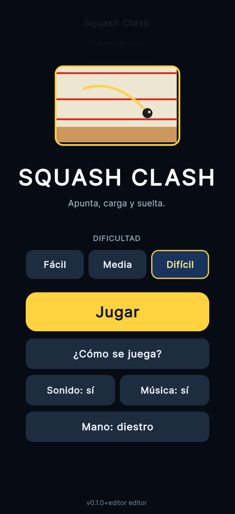 | 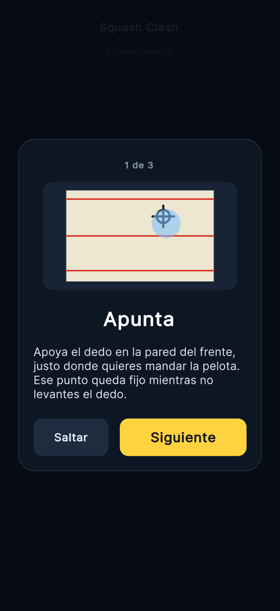 | 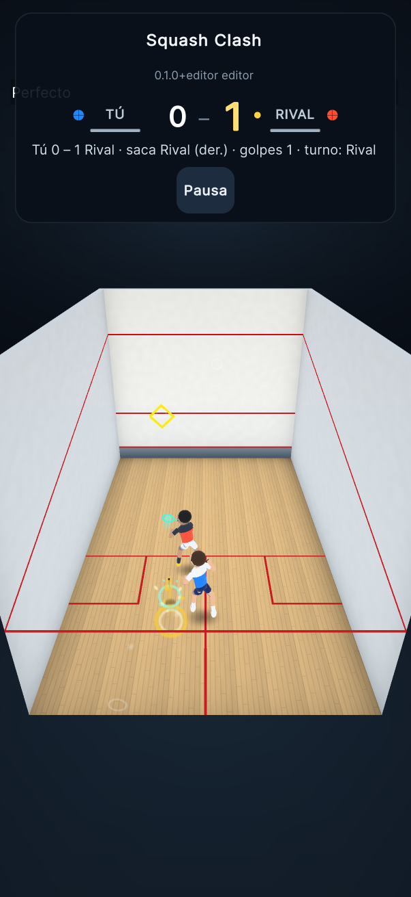 | 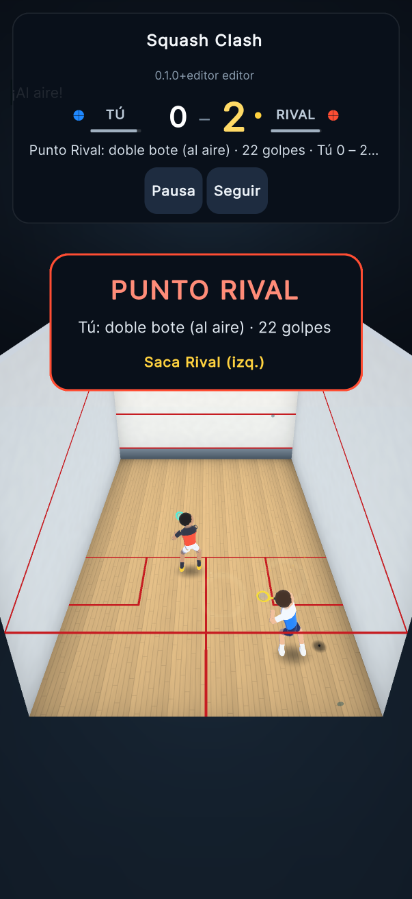 | 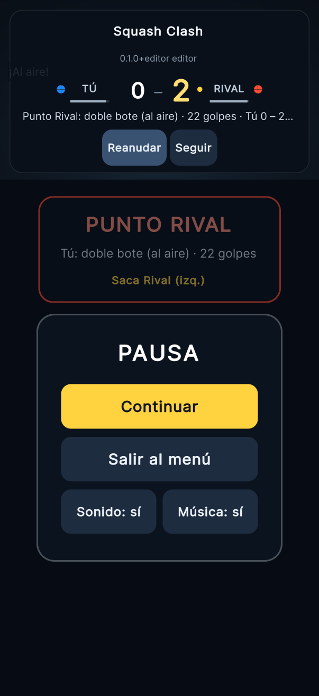 | 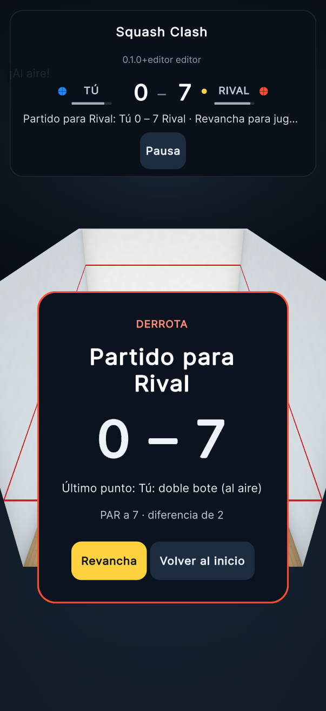 |
| Después | 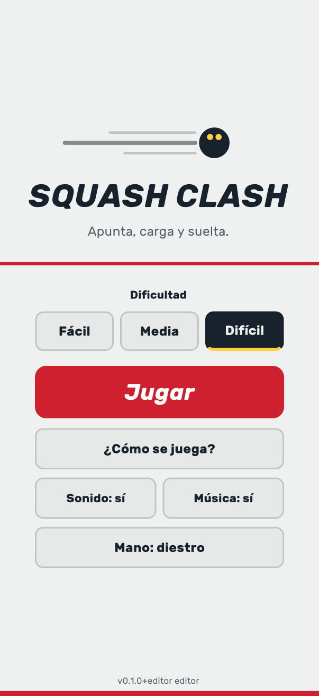 | 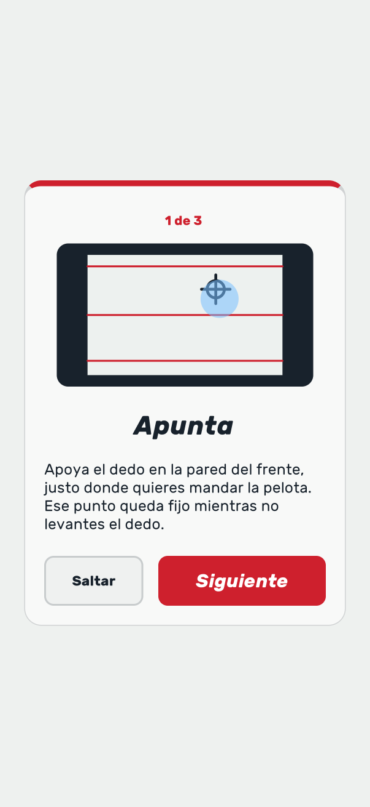 | 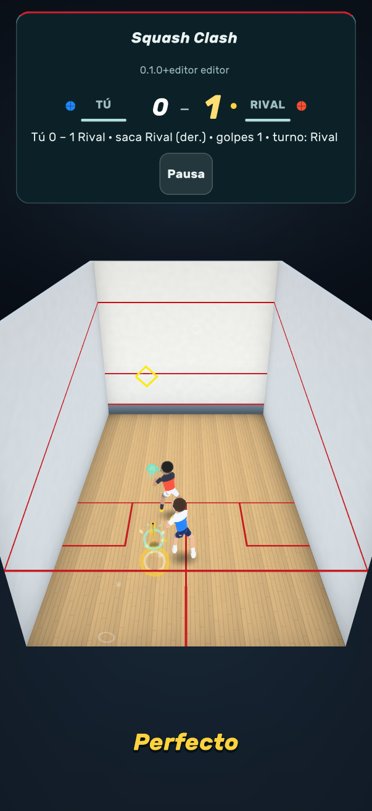 | 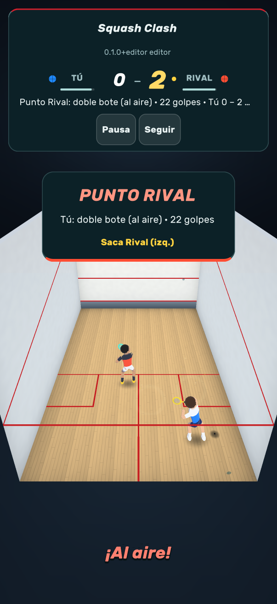 | 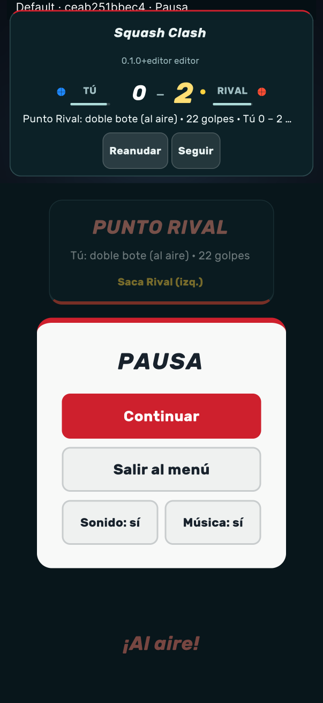 | 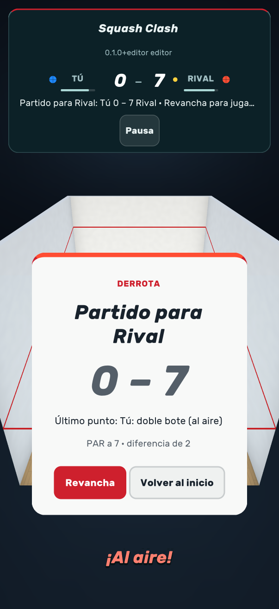 |

«Antes» se tomó con el runtime de `75b9ce8` y el arnés de esta rama. Las demás (menú dev, Difícil, tutorial 2 y 3, partido) están en las mismas carpetas.

## Compuertas (sobre `5b18aef`, un solo Unity con candado)

EditMode **803/803**, PlayMode **616/616** (611 de `main` + 5 nuevos), `scripts/check-release.sh` **dev y prod OK** (build 871, módulos esperados). AutoQA **exento**: no se toca timing, gesto ni contrato de contacto, solo vistas y estilo.

## Dudas y observaciones

- **Kerning apagado.** TextCore leyó mal los pares de Rubik (letras encimadas en «SQUASH CLASH» y «PAUSA») y además triplicaba el tamaño; los tres assets van sin rasgos de fuente. Un atlas generado en tiempo de ejecución desde el .ttf también perdía glifos; por eso son estáticos. Peso en el repo: unos 2,2 MB por cara.
- **OFL en la app:** la licencia está en el repo junto a las fuentes. Si el PO lo quiere, se muestra en una pantalla de créditos antes de publicar.
- En el arnés y en los tests el `ShotController` está apagado, y es él quien aplica `timing.showNotes` en cada cuadro; por eso la nota no salía en la captura original. La captura y el test ahora hacen esa misma llamada. En «antes» la nota aparece arriba porque la vista vieja se ubicaba con `Screen`, que en el editor no es el tamaño de la captura; en el teléfono iba abajo.
- Las capturas dibujan opacos los velos translúcidos (arnés, ya visto en #59). En la de pausa aparece una línea «Default · … · Pausa» que ya estaba antes (editor con `SQUASH_DEV`); no viene de este cambio.
- El indicador de carga y el anillo de timing son 3D (LineRenderer) y no se tocaron. Quedan para otra pasada si el PO quiere.
- Falta verlo en el iPhone: contraste al sol y tamaño de la cursiva.
