# Menú principal y créditos — informe

Rama `claude/menu-redesign` desde `f068cee` (integración de la PR #84). **Sin push, PR, fusión ni instalación.** Lo hizo un subagente Opus dirigido por Claude, así que la revisión de Claude no es independiente. Encargo del PO, literal: «mejorar el diseño con frontend design del menú principal», más una pantalla de créditos antes de publicar.

## Dirección

El menú del 18 nov ya era «la pared frontal», pero todo iba centrado y del mismo ancho: el logotipo era un título más y Jugar apenas se distinguía de los botones secundarios (1,28 veces su área). Ahora **la pantalla es la pared frontal a escala y se lee de arriba abajo como en la cancha**: arriba la línea de out; en la zona de juego, sobre la línea de saque, el logotipo, que es donde tiene que caer cada golpe; bajo esa línea, las opciones al alcance del pulgar, y abajo del todo la chapa. Todo va alineado a la izquierda con un margen de 24 pt. Lo audaz está en un solo lugar: «SQUASH / CLASH» en Rubik negrita cursiva de 72 pt, a dos líneas y apoyado en la línea de saque, con la pelota **aplastándose contra la pared** justo después de «CLASH» (ovalada, como en el instante del impacto, con su estallido en rojo de línea). Encima quedan marcas de pelota, tenues, como las de cualquier frontis. Lo demás es sobrio: el nivel es un control segmentado de una sola pieza («Nivel del rival»), Jugar es la única losa roja (76 pt, con un borde inferior más oscuro para que se lea como algo que se presiona), «¿Cómo se juega?» y «Créditos» van en placas tenues lado a lado, y Sonido, Música y Mano son píldoras que se atenúan cuando están en «no». Se conservan los colores (yeso, tinta, rojo de línea, amarillo de la pelota) y la tipografía del 18 nov, para que tutorial, pausa y fin sigan siendo de la misma familia.

**Créditos** (nueva, desde el menú): Rubik de Hubert & Fischer con su línea de copyright tal como figura en la tabla `name` del archivo (ID 0, la misma de `OFL.txt`) y la licencia SIL Open Font License 1.1; además, el origen del sonido y la música, resumido de `Resources/Audio/PROVENANCE.md` (generados con código para el juego, sin grabaciones, samples ni bibliotecas externas). «Volver» regresa al menú; por código, en créditos suena la música del menú (`MusicPlayer` la elige para toda pantalla distinta de None).

## Iteraciones (iPhone 16 Pro en el editor; «con márgenes» simula la isla y el indicador de inicio)

| | Menú prod | Menú dev | Menú con márgenes | Créditos |
|---|---|---|---|---|
| Antes (`f068cee`) | 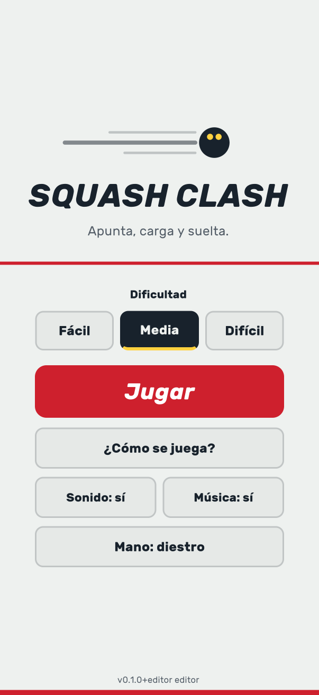 | 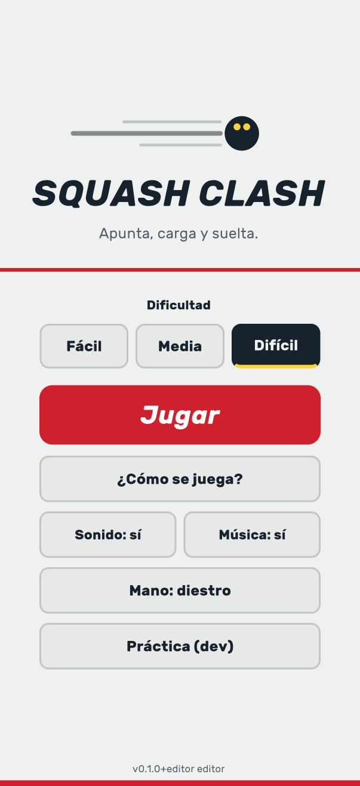 | — | — |
| Iteración 1 | 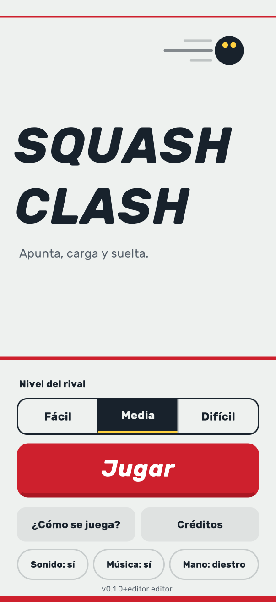 | 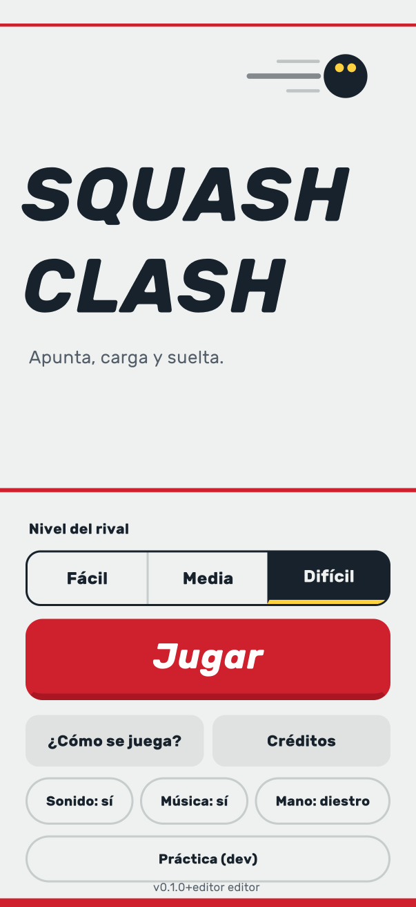 | 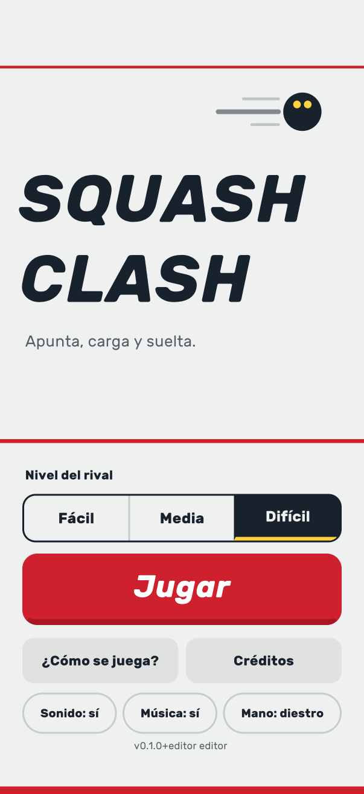 | 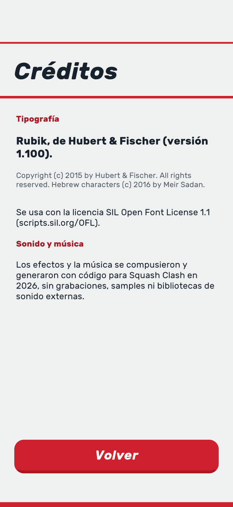 |
| Iteración 2 | 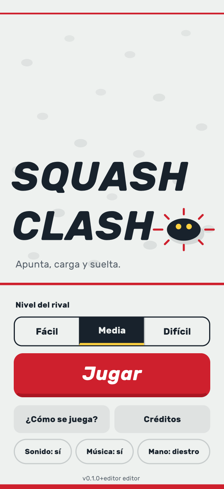 | 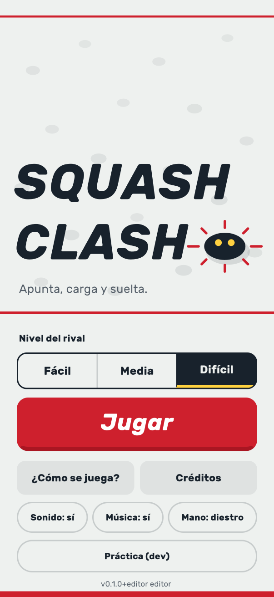 | 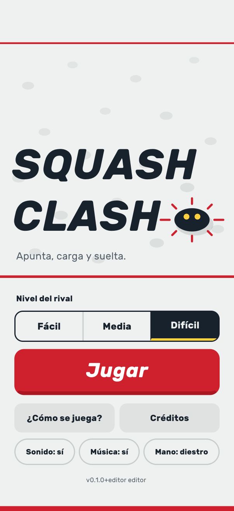 | 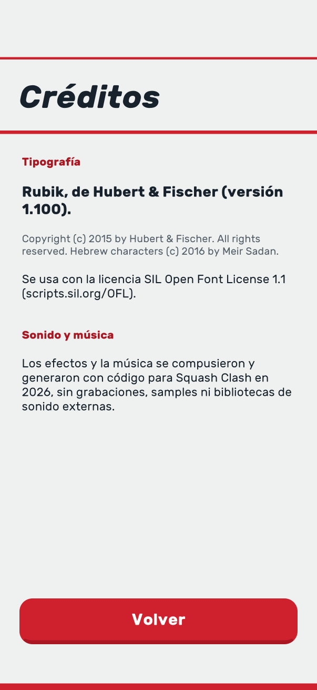 |
| Final | 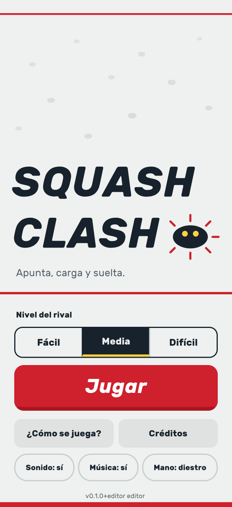 | 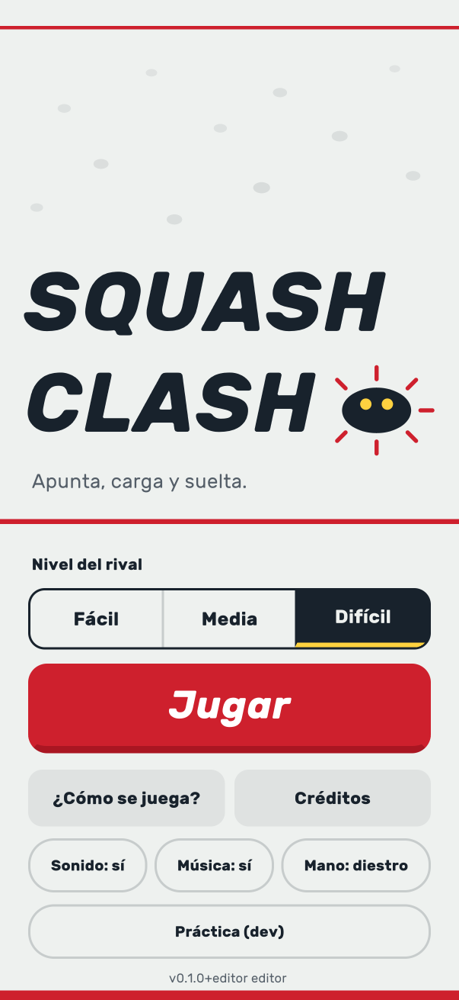 | 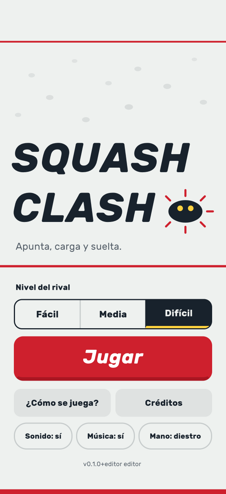 | 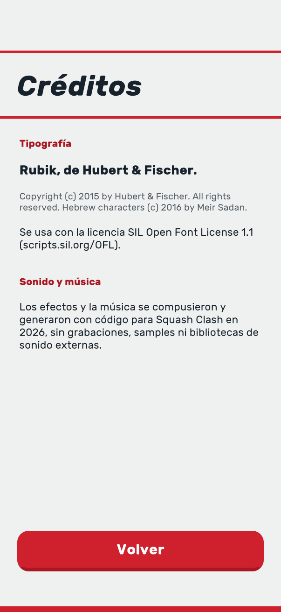 |

Lo que juzgué en cada una. **Iteración 1:** la jerarquía mejoró (logotipo grande, nivel segmentado, losa roja), pero la parte de arriba quedaba vacía y la pelota con estela flotaba arriba a la derecha sin relación con el logotipo; además, el número de versión quedaba pegado a las píldoras. **Iteración 2:** la pelota aplastada después de «CLASH» ya funciona como logotipo, pero las marcas parecían lunares grises detrás de las letras y del lema, el trazo izquierdo del estallido se leía como un guion («CLASH-») y la mancha bajo la pelota parecía una sombra. **Final:** marcas más chicas y tenues, solo sobre el logotipo y ninguna en pantallas 16:9, sin trazo del lado del texto y sin mancha; en créditos, sin cortes de línea huérfanos y con mejor espaciado.

## Qué cambió

`FirstRunFlow.cs`: el menú se reorganiza en bloques (`menu-hero`, `menu-wordmark`, `menu-controls`, `menu-links`), con capa `credits-layer`, `FirstRunScreen.Credits`, `OpenCredits`/`CloseCredits`, métrica `credits`, el dibujo de la pelota aplastada y de las marcas, y la clase `sc-toggle--off` en los interruptores (menú y pausa). `Hud.uss`: estilos del menú y de créditos; se retiran `sc-menu-wide`/`-pair`/`-half`, que ya no se usan. **Se conservan todos los nombres, textos y comportamientos** que usan las pruebas y el flujo (Jugar, niveles, «¿Cómo se juega?», Sonido/Música/Mano, Práctica (dev), versión). Único cambio de texto: «Dificultad» → «Nivel del rival», que ninguna prueba fija. Sin cambios en AGENTS, DefaultPreset, Core, física, timing, contrato, reloj, GesturePreview, ProjectSettings ni Packages. AutoQA queda **exento**: solo cambian vistas.

## Pruebas (TDD)

Agregadas, **ninguna existente modificada**: `ZFirstRunMenuTests` (créditos ida y vuelta con el copyright literal; botones de al menos 44×44 pt en menú dev/prod y créditos), `ZDeviceLayoutTests.Credits_FitInsideTheSafeArea` (SE, mini, Pro y Pro Max), `ZUiLookTests` (Jugar con al menos 1,4 veces el área de cualquier otro botón y el logotipo como el texto más grande, con 56 pt o más; interruptores apagados marcados; créditos en Rubik y con contraste AA). **RED 9/9 por aserción** (`missing element menu-credits`, «Jugar against menu-howto», «sound off is marked»). Durante el GREEN, la regla de 44 pt detectó que unos botones de 44 pt quedaban en 43,88 al ajustarse al píxel. Se subieron a 46 pt, como ya estaban los de la tarjeta de resultado. El arnés `ZFirstRunCapture` suma dos tomas: el menú con márgenes reales y los créditos.

**Suites completas, sin filtro, sobre el código final:** EditMode **870/870**, PlayMode **674/674** (9 casos nuevos; la base no se corrió aparte), sin errores CS. Un solo Unity, con candado.

## Riesgos y dudas

- **Texto completo de la OFL en la app:** la licencia exige acompañar la fuente con el aviso de copyright y la licencia. Créditos muestra el aviso, el nombre de la licencia y su URL, pero el texto completo (`Visual/Fonts/OFL.txt`) no está en `Resources`, así que la build no lo incluye. Mostrarlo entero en créditos es simple, pero lo decide el PO.
- El logotipo de 72 pt deja poco margen en el SE (375 pt): «SQUASH» ocupa unos 300 de los 327 pt disponibles. Las pruebas de ajuste pasan, pero falta verlo en el teléfono.
- El interlineado del logotipo es el de la fuente: USS no tiene `line-height` y no se tocó el asset de fuente.
- Las capturas de «antes» no traen las tomas con márgenes ni la de créditos, porque se agregaron al arnés en esta rama.
- Falta verlo en el iPhone: el tamaño del logotipo, el estallido rojo y lo tenue de las marcas al sol.
